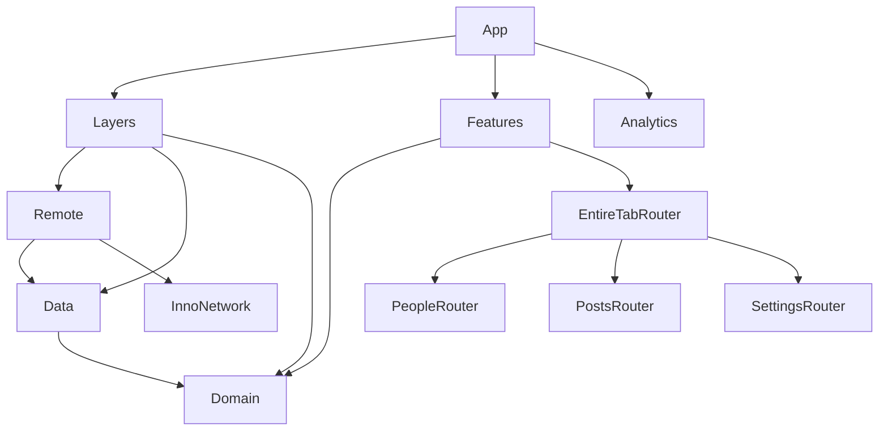

# InnoSample

[](https://github.com/InnoSquadCorp/InnoSample/actions/workflows/verify.yml)

[English](README.md) | [한국어](README.ko.md) | [Español](README.es.md) | [Deutsch](README.de.md) | [简体中文](README.zh-Hans.md) | [日本語](README.ja.md) | [Русский](README.ru.md)

Eine modulare SwiftUI-App und Ausgangsbasis für neue Projekte mit den veröffentlichten APIs von **InnoDI, InnoFlow, InnoNetwork und InnoRouter**. Drei Features zeigen Dependency-Komposition, asynchrones Laden, typisierte Navigation, Intents zwischen Features und die Lebensdauer nativer Präsentationen.

Dieses README beschreibt die eingecheckte App. Der [Architekturbericht](Docs/ArchitectureReview.md) dokumentiert weitere API-Abdeckung und Validierungsgrenzen. Alle sieben READMEs enthalten dieselben Beispiele und Befehle; die Lokalisierung der App-Oberfläche ist eine separate Aufgabe.

<!-- section:requirements -->
## Voraussetzungen und Abhängigkeiten

- macOS mit **Xcode 27.1 / Swift 6.4**; Sprachmodus des Projekts: Swift 6.3.
- **Tuist 4.202.5** und ripgrep 15.1.0, festgelegt in [.mise.toml](.mise.toml). Diese Tuist-Version erhält InnoNetworks standardmäßigen Package-Trait `Macros`.
- App: **iOS/iPadOS 18+, macOS 15+**. Mitgelieferte Watch-App: **watchOS 11+**.
- Gemeinsame Modul-Manifeste deklarieren zusätzlich tvOS 18+ und visionOS 2+. Die vollständige App-CI prüft iOS, die Watch-App und macOS.

| Bibliothek | Exakte Version | Verantwortung |
| --- | --- | --- |
| [InnoDI](https://github.com/InnoSquadCorp/InnoDI/tree/7.0.2) | 7.0.2 | Container, generierte Provider/Overrides und Prüfung des Abhängigkeitsgraphen |
| [InnoFlow](https://github.com/InnoSquadCorp/InnoFlow/tree/6.0.2) | 6.0.2 | Zustand, Aktionen, Phasen, asynchrone Effekte und typisierte Outputs |
| [InnoNetwork](https://github.com/InnoSquadCorp/InnoNetwork/tree/6.1.1) | 6.1.1 | Endpoint-Makros, Transport, Authentifizierung, Wiederholungen und HTTP-Cache |
| [InnoRouter](https://github.com/InnoSquadCorp/InnoRouter/tree/7.0.0) | 7.0.0 | Routen, Tabs, Deep Links, Stack-/Split-Hosts und typisierte Präsentationsergebnisse |

Der [Dependency-Helper](Tuist/ProjectDescriptionHelpers/Dependency/TargetDependency+.swift) deklariert exakte Remote-Releases. Jedes Projekt benennt seine verwendeten Packages. [Tuist/Package.swift](Tuist/Package.swift) enthält bewusst keine globalen Package-Abhängigkeiten oder Linkage-Overrides. Generierte Projekte, Workspaces und Lockfiles werden ignoriert; `make verify-versions` prüft Release-Revisionen und SwiftSyntax 604.0.0 im generierten Graphen.

<!-- section:run -->
## App ausführen

Zuerst mise und das gewählte Xcode installieren, dann:

```bash
git clone https://github.com/InnoSquadCorp/InnoSample.git
cd InnoSample
mise install
make install-dependencies
make generate
make open
```

Das Scheme **InnoSampleApp** und einen iOS-Simulator oder den Mac wählen. **InnoSampleWatchApp** ist das enthaltene Watch-Target. Signierung ist im Beispiel-Manifest deaktiviert; für physische Geräte ist eine eigene Signierungskonfiguration erforderlich.

Die normale App verwendet JSONPlaceholder über Remote. Debug-Starts mit `--uitesting` ersetzen Repositories durch generierte DI-Overrides und behalten die tatsächliche Feature-, Reducer- und Router-Komposition bei. Native UI-Tests verwenden diesen deterministischen Fixture-Pfad.

<!-- section:features -->
## Features des Beispiels

| Feature | Daten | Interaktionen |
| --- | --- | --- |
| People | `/users` | Liste, Detail, Overview-Sheet, Intent zum Settings-Detail einer zuständigen Person |
| Posts | `/posts` | Liste, Detail, Highlights-Sheet; kompakter Stack und breiter Split mit zwei Spalten |
| Settings | `/todos` | Liste, Detail, Filter für abgeschlossene Einträge, Digest-Ergebnis, Intent zum People-Detail |
| EntireTab | Gemeinsame Child-Coordinators | Generierte Tab-Identitäten/Ziele; vermittelt People ↔ Settings und Deep Links |

Der generierte Resolver akzeptiert das Scheme `innosample` und den Host `host`. Mit installierter App auf einem gestarteten Simulator lassen sich diese Links testen:

```bash
xcrun simctl openurl booted 'innosample://host/people/1'
xcrun simctl openurl booted 'innosample://host/settings/1'
```

Die Watch-App zeigt einen festen People-Snapshot mit nativer Listen-/Detailnavigation und verwendet gemeinsame Domain-Modelle. Synchronisierung und Netzwerk-Laden auf der Watch sind nicht Teil der aktuellen Implementierung.

<!-- section:architecture -->
## Modulgrenzen

Jedes Modul besitzt eine eigene `Project.swift`; [Workspace.swift](Workspace.swift) setzt sie zusammen. Pfeile zeigen Compile-Abhängigkeiten. Zur Laufzeit komponiert Layers Remote → Data → Domain und stellt Features `FeatureUseCaseContaining` bereit.



| Grenze | Verantwortung |
| --- | --- |
| App | Root-Container, Analytics-Adapter, Layers/Features-Komposition und Lebenszyklus |
| Domain | Entitäten, Repository-Protokolle und konkrete zustandslose `callAsFunction()`-Use-Cases über gemeinsamen Repositories |
| Data | Repository-Implementierungen, Remote-Datenquellenverträge, DTO-Mapping und Datenrichtlinien |
| Remote | Endpoints, Decodierung, Transportregeln und Implementierungen der Remote-Verträge von Data |
| Layers | Nur Komposition; Use-Cases für Features ohne Offenlegung interner Container |
| Features | Root-Komposition der Child-Router-Targets über Domain-Use-Case-Eingaben |
| Leaf Interface / Logic / UI / Router | Öffentliche Ein-/Ausgaben / Zustand und Effekte / Darstellung und Callbacks / Routen und Präsentationen |
| Leaf Testing / Tests | Fixtures und Hilfen / ausführbare Regressionstests |
| ThirdParties/Analytics | SDK-Wrapper-Beispiel: Interface-Framework, statische Implementierung und Tests |
| Utils/SampleDesignSupport | Gemeinsame UI-Komponenten für Laden, Fehler, Metriken und weitere Inhalte |

Logic importiert Domain und InnoFlow; SwiftUI und InnoRouter bleiben an der UI-/Router-Grenze. UI nutzt Interface-/Modellverträge ohne direkte Imports von Domain, Data, Remote oder InnoRouter. Benachbarte Features tauschen typisierte Intents über EntireTab aus, ohne gegenseitig ihre Router zu importieren. [LinkagePolicy](Docs/LinkagePolicy.md) beschreibt dynamische Kompositions-/Interface-Frameworks und statische Implementierungs-Targets.

<!-- section:macros -->
## Makro-Integration

### InnoDI: Konstruktion und Lebensdauer

Der vollständige [People-Container](Features/PeopleFeature/Router/Coordinator/PeopleFeatureContainer.swift) hält seinen Coordinator mit generierter Initialisierung und einem gemeinsamen Provider:

<!-- source:Features/PeopleFeature/Router/Coordinator/PeopleFeatureContainer.swift -->
```swift
import InnoDI
import PeopleFeatureInterface

@DIContainerRole(role: ContainerRole.local, mainActor: true)
public struct PeopleFeatureContainer {
    @Input
    public var input: PeopleFeatureInput

    @Provide(.shared, PeopleFeatureCoordinator.self, with: [\Self.input])
    public var coordinator: PeopleFeatureCoordinator
}
```

[AppContainer](App/Sources/AppContainer.swift) verwendet `@DIContainerRole` mit Root-Rolle, einen Analytics-Provider bei Bedarf und `@SubContainer` mit Key-Path-Bindings und `featureRoot:`. Die App ruft den generierten Root-View-Helper auf. Container-Targets binden `InnoDIDAGValidationPlugin` ein; Tests decken generierte Overrides, Prewarming, Vorbereitung/Wiederholung/Schließen asynchroner Provider, Multibindings und `@GenerateMock` ab. Die App verwendet InnoDI direkt; ihr einfacher Feature-Root-Helper benötigt keinen InnoDISwiftUI-Host.

### InnoFlow: Zustand und Effekte

Produktions-Reducer verwenden `@InnoFlow(phaseManaged: true, strictPhaseTotality: true)`, verschachtelte State/Action/Output-Typen und Phase-Maps mit generierten Case-Paths. Dieser Ausschnitt des [Settings-Reducers](Features/SettingsFeature/Logics/Reducer/SettingsFeatureReducer.swift) wandelt Erfolg/Fehler in Aktionen um und ersetzt einen laufenden Ladevorgang:

<!-- source:Features/SettingsFeature/Logics/Reducer/SettingsFeatureReducer.swift -->
```swift
    private func loadTodos() -> ReducerEffect<Action, Output> {
        let loadTodos = dependencies.loadTodos

        return .perform(
            operation: { try await loadTodos() },
            success: Action.todosLoaded,
            failure: { error in
                .todosFailed((error as? LocalizedError)?.errorDescription ?? error.localizedDescription)
            }
        )
        .cancellable("settings-feature-load", cancelInFlight: true)
    }
```

Settings verwendet `@BindableField` für den Filter und ein beschreibbares Observable-Modell für UI-Bindings mit `@Bindable`. Feature-Modelle erfassen begrenzte typisierte Outputs beim Dispatch, konsumieren sie mit `for await` und beenden die Erfassung. Logic-Tests verwenden vollständige TestStore-Assertions, ManualTestClock und Instrumentierung mit ausgeblendeten sensiblen Daten.

### InnoNetwork: Endpoints und Richtlinien

Der vollständige [People-Endpoint](Layers/Remote/Sources/User/Requests/FetchUsersRequest.swift) überlässt Methode/Pfad/Authentifizierung und die Erzeugung der Protokollanforderungen `@APIDefinition`:

<!-- source:Layers/Remote/Sources/User/Requests/FetchUsersRequest.swift -->
```swift
import Data
import InnoNetwork

@APIDefinition(method: .get, path: "/users", auth: .anonymous)
struct FetchUsersRequest: RemoteRequest {
    typealias APIResponse = [UserRemoteModel]

    var featureName: String { "People" }
}
```

[RemoteClientFactory](Layers/Remote/Sources/Infrastructure/RemoteClientFactory.swift) begrenzt Bearer-Refresh/Replay auf `/todos`, verwendet begrenzte exponentielle Wiederholungen und einen Timeout von 20 Sekunden sowie RFC-9111-Caching über einer Cache-first-Richtlinie von 300 Sekunden. Der persistente Cache ist auf 25 MiB / 500 Einträge begrenzt. Stabile Metadaten erhalten die GET-Cache-Wiederverwendung. Token-Rotation ist eine Beispielimplementierung; JSONPlaceholder besitzt keinen echten Authentifizierungsdienst.

### InnoRouter: generierte Verträge

[SampleTab](Features/EntireTabFeature/Router/Tab/SampleTab+InnoRouterTab.swift) verbindet `@Router` mit stabilen `@TabItem(id:)`-Deklarationen; die Shell nutzt den generierten Katalog in einer nativen TabView. [SampleDeepLink](Features/EntireTabFeature/Router/DeepLink/SampleDeepLink.swift) verwendet `@DeepLink` und eine Liste zulässiger Ursprünge. Leaf-Routen-Enums generieren Ziele und typisierte Helper.

Router-Views senden Befehle mit `@EnvironmentRouter` und lesen den Präsentationszustand mit `@EnvironmentRouterState`. Digest deklariert `@PresentationResult(Bool.self)`: Explizites Close liefert einen Wert und bestätigt einmal; Schließen per Geste, Abbruch und Ablehnung sind getrennte Ergebnisse. Tests prüfen zudem begrenzte Codable-Snapshots, Drafts, Revisionen/Ereignisse und den Abschluss von RouterTestStore.

<!-- section:navigation -->
## Navigationseigentum und adaptive Posts

Der gemeinsame EntireTab-Coordinator besitzt die generierte Tab-Auswahl. Jedes Leaf besitzt seinen Stack-/Split-Host; die Umgebungen aller Child-Coordinators werden oberhalb der Tab-Ziele injiziert. So setzen verschachtelte native Navigationscontainer den Child-Pfad beim Tab-Wechsel nicht zurück.

Posts hält einen konfigurierten RouterStore im gemeinsamen Coordinator. Der Tab-Viewport beobachtet die Breite: Unter **800 pt** rendert er RouterHost, ab dieser Breite RouterSplitHost mit Listen-/Detailspalten. `replaceHost` bewahrt die gesamte Detailhistorie im selben Store. Bei aktiver Präsentation bleiben Host und Dismissal-Handle erhalten; das zuletzt angeforderte Layout wird nach dem Schließen angewandt. Tests prüfen beide Richtungen, Tab-Rückkehr, Highlights, Close und Back.

<!-- section:validation -->
## Validierung

```bash
make verify-docs
make verify
make test-ui
make verify-ci
```

| Befehl | Umfang |
| --- | --- |
| `make verify-docs` | Abgleich von Abschnitten/Code/Links in sieben Sprachen, Release-Tabelle, Quellausschnitten und lokalen Links einschließlich Groß-/Kleinschreibung |
| `make verify` | Installation/Generierung, Dokumentation, aufgelöste Releases, Import-Grenzen, exakter Release-DI-DAG, 11 macOS-Testsuites, iOS + Watch- und macOS-Build |
| `make test-ui` | Sechs native UI-Regressionstests auf einem dedizierten iPad-mini-Simulator |
| `make verify-ci` | Vollständiges `make verify`, anschließend `make test-ui` |

Einzelne Targets: `make test-domain`, `make test-data`, `make test-remote`, `make test-leaf-features`, `make test-layers`, `make test-features`, `make test-analytics`, `make test-app`, `make build-app`, `make build-macos`.

UI-Abdeckung: People → Settings → People und Overview; Posts-Auswahl/Highlights; Detailerhalt bei Tab- und Stack-/Split-Wechseln; Highlights in beiden Breiten und Rückkehr zum Detail; Settings-Filter und einmalige Digest-Bestätigung; Gestenschließen ohne Bestätigung.

Die Auswahl bevorzugt iPad mini (A17 Pro), danach iPad mini (6th generation), mit installiertem kompatiblem iOS-Runtime. Der Boot endet vor Start des Test-Timers; der verwaltete Simulator wird anschließend heruntergefahren. Ein vorhandenes Gerät oder ein xcresult-Pfad lässt sich angeben:

```bash
make test-ui SIMULATOR_ID=<simulator-udid>
UI_TEST_RUNTIME_VERSION=27.0 UI_TEST_RESULT_BUNDLE=/tmp/InnoSampleUI.xcresult make test-ui
```

[GitHub Actions](.github/workflows/verify.yml) führt denselben Ablauf bei main-Pushes und Pull Requests mit Xcode 27.1 / iOS 27.0 aus und lädt native UI-Ergebnisse hoch. CLI-Flags zum Überspringen der Vertrauensbestätigung behalten Makro-Kompilierung und DAG-Prüfung bei. Fixture-Erfolg und unsignierte Builds bestätigen weder Live-Server-Verhalten noch Geräteinstallation oder Veröffentlichung.

<!-- section:maintenance -->
## Pflege und weitere Dokumentation

Bei API- oder Befehlsänderungen alle sieben READMEs aktualisieren und `make verify-docs` ausführen. Der Check vergleicht Abschnitts-IDs, Codeblöcke, Linkziele, Release-Pins und Quellausschnitte. Übersetzte Texte werden zusammen mit Englisch gepflegt.

- [ArchitectureReview](Docs/ArchitectureReview.md): API-Abdeckung, Eigentumsentscheidungen und datierte Nachweise (Koreanisch).
- [LinkagePolicy](Docs/LinkagePolicy.md): Package-Produkte und dynamisches/statisches Linking (Koreanisch).
- [Tuist helpers](Tuist/ProjectDescriptionHelpers): Target-Vorlagen, Plattformen, Abhängigkeiten und Schemes.
- [Native UI tests](App/UITests/InnoSampleAppUITests.swift): ausführbare App-Abläufe.

Optionale WebSocket/upload/download/OpenAPI/AWS/trust-Produkte, InnoStream, Protobuf und InnoBase gehören nicht zum Funktionsumfang dieser App. Router-Snapshot-Tests bedeuten keine App-Wiederherstellung von Datenträger; Window-/Immersive-Driver und ein Inspector sind ebenfalls nicht enthalten.
