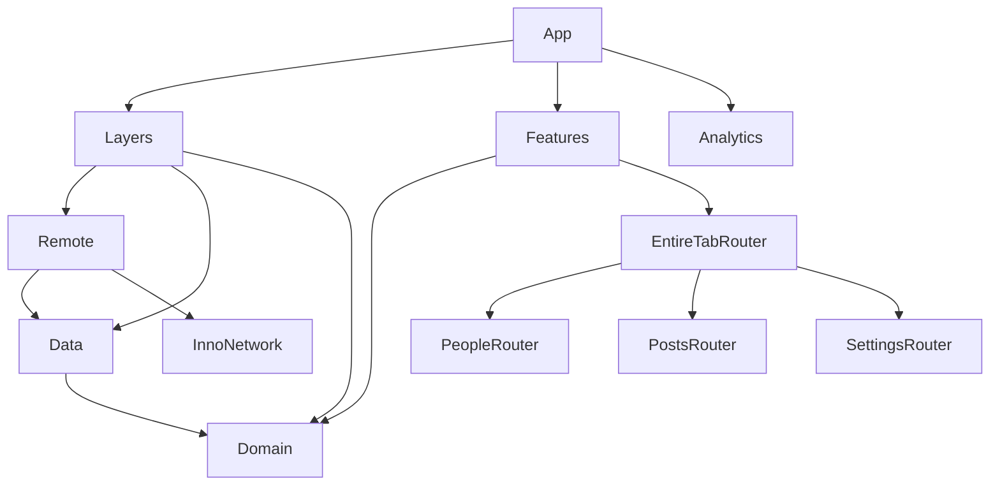

# InnoSample

[](https://github.com/InnoSquadCorp/InnoSample/actions/workflows/verify.yml)

[English](README.md) | [한국어](README.ko.md) | [Español](README.es.md) | [Deutsch](README.de.md) | [简体中文](README.zh-Hans.md) | [日本語](README.ja.md) | [Русский](README.ru.md)

Una aplicación SwiftUI modular y una base para nuevos proyectos que combina las API publicadas de **InnoDI, InnoFlow, InnoNetwork e InnoRouter**. Tres funciones muestran composición de dependencias, carga asíncrona, navegación tipada, intenciones entre funciones y ciclos de vida de presentaciones nativas.

Este README describe la aplicación del repositorio. La [revisión de arquitectura](Docs/ArchitectureReview.md) recoge otras API y los límites de validación. Los siete README incluyen los mismos ejemplos y comandos; la localización de la interfaz de la aplicación es una tarea aparte.

<!-- section:requirements -->
## Requisitos y dependencias

- macOS con **Xcode 27.1 / Swift 6.4**; el proyecto usa el modo de lenguaje Swift 6.3.
- **Tuist 4.202.5** y ripgrep 15.1.0, fijados en [.mise.toml](.mise.toml). Esta versión de Tuist conserva el trait de paquete `Macros` predeterminado de InnoNetwork.
- Aplicación: **iOS/iPadOS 18+, macOS 15+**. Aplicación complementaria para el reloj: **watchOS 11+**.
- Los módulos compartidos también declaran tvOS 18+ y visionOS 2+. La validación completa de CI cubre iOS, su aplicación complementaria para el reloj y macOS.

| Biblioteca | Versión exacta | Responsabilidad |
| --- | --- | --- |
| [InnoDI](https://github.com/InnoSquadCorp/InnoDI/tree/7.0.1) | 7.0.1 | Contenedores, proveedores y sustituciones generados, validación del grafo |
| [InnoFlow](https://github.com/InnoSquadCorp/InnoFlow/tree/6.0.2) | 6.0.2 | Estado, acciones, fases, efectos asíncronos y salidas tipadas |
| [InnoNetwork](https://github.com/InnoSquadCorp/InnoNetwork/tree/6.1.1) | 6.1.1 | Macros de endpoints, transporte, autenticación, reintentos y caché HTTP |
| [InnoRouter](https://github.com/InnoSquadCorp/InnoRouter/tree/7.0.0) | 7.0.0 | Rutas, pestañas, enlaces profundos, hosts stack/split y resultados tipados |

El [helper de dependencias](Tuist/ProjectDescriptionHelpers/Dependency/TargetDependency+.swift) declara versiones remotas exactas. Cada proyecto enumera los paquetes que consume. [Tuist/Package.swift](Tuist/Package.swift) no contiene dependencias globales ni cambios de enlace. Los proyectos, espacios de trabajo y archivos de resolución generados se excluyen de Git; `make verify-versions` comprueba las revisiones publicadas y SwiftSyntax 604.0.0 en el grafo generado.

<!-- section:run -->
## Ejecutar la aplicación

Instala mise y el Xcode elegido; después ejecuta:

```bash
git clone https://github.com/InnoSquadCorp/InnoSample.git
cd InnoSample
mise install
make install-dependencies
make generate
make open
```

Selecciona el esquema **InnoSampleApp** y un simulador iOS o tu Mac. **InnoSampleWatchApp** es el target del reloj incluido. La firma está desactivada en el manifiesto de ejemplo; instalar en un dispositivo físico requiere tu propia configuración de firma.

La ejecución normal usa JSONPlaceholder a través de Remote. En Debug, `--uitesting` sustituye repositorios mediante las sustituciones DI generadas y conserva la composición real de funciones, reducers y routers. Las pruebas nativas de interfaz usan estos datos deterministas.

<!-- section:features -->
## Funciones del ejemplo

| Función | Datos | Interacciones |
| --- | --- | --- |
| People | `/users` | Lista, detalle, hoja Overview, intención para abrir el detalle de Settings del responsable |
| Posts | `/posts` | Lista, detalle, hoja Highlights; stack compacto y split amplio de dos columnas |
| Settings | `/todos` | Lista, detalle, filtro de completados, resultado Digest, intención para abrir el detalle de People |
| EntireTab | Coordinadores hijos compartidos | Identidades y destinos de pestaña generados; media entre People ↔ Settings y enlaces profundos |

El resolver generado acepta el esquema `innosample` y el host `host`. Prueba estos enlaces con la aplicación instalada en un simulador arrancado:

```bash
xcrun simctl openurl booted 'innosample://host/people/1'
xcrun simctl openurl booted 'innosample://host/settings/1'
```

La aplicación del reloj muestra una instantánea fija de People con navegación nativa de lista/detalle y comparte modelos Domain. La sincronización y la carga por red del reloj quedan fuera de la implementación actual.

<!-- section:architecture -->
## Límites de módulos

Cada módulo tiene su propio `Project.swift`; [Workspace.swift](Workspace.swift) los reúne. Las flechas muestran dependencias de compilación. En ejecución, Layers compone Remote → Data → Domain y expone `FeatureUseCaseContaining` a Features.



| Límite | Responsabilidad |
| --- | --- |
| App | Contenedor raíz, adaptador de analítica, composición Layers/Features y ciclo de vida |
| Domain | Entidades, protocolos de repositorio y casos de uso concretos sin estado con `callAsFunction()` sobre repositorios compartidos |
| Data | Repositorios, contratos de fuentes remotas, mapeo DTO y políticas de datos |
| Remote | Endpoints, decodificación, transporte e implementaciones de los contratos remotos de Data |
| Layers | Solo composición; casos de uso para funciones sin exponer contenedores internos |
| Features | Composición raíz de targets Router hijos mediante casos de uso de Domain |
| Leaf Interface / Logic / UI / Router | Entradas/salidas públicas / estado y efectos / representación y callbacks / rutas y presentaciones |
| Leaf Testing / Tests | Datos y helpers de prueba / pruebas de regresión ejecutables |
| ThirdParties/Analytics | Ejemplo de adaptador SDK: framework de interfaz, implementación estática y pruebas |
| Utils/SampleDesignSupport | Componentes compartidos de carga, error, métricas y otra interfaz |

Logic importa Domain e InnoFlow, dejando SwiftUI e InnoRouter en el límite UI/router. UI consume contratos de interfaz/modelo sin importar directamente Domain, Data, Remote o InnoRouter. Las funciones hermanas intercambian intenciones tipadas mediante EntireTab sin importar sus routers entre sí. [LinkagePolicy](Docs/LinkagePolicy.md) explica los frameworks dinámicos de composición/interfaz y los targets estáticos de implementación.

<!-- section:macros -->
## Integración de macros

### InnoDI: construcción y ciclo de vida

El [contenedor People](Features/PeopleFeature/Router/Coordinator/PeopleFeatureContainer.swift) completo usa inicialización generada y un proveedor compartido para conservar su coordinador:

<!-- source:Features/PeopleFeature/Router/Coordinator/PeopleFeatureContainer.swift -->
```swift
import InnoDI
import PeopleFeatureInterface

@DIContainerRole(role: ContainerRole.local, mainActor: true)
public struct PeopleFeatureContainer {
    @Input
    public var input: PeopleFeatureInput

    @Provide(.shared, PeopleFeatureCoordinator.self, with: [\Self.input])
    public var coordinator: PeopleFeatureCoordinator
}
```

[AppContainer](App/Sources/AppContainer.swift) usa `@DIContainerRole` con rol raíz, un proveedor de analítica bajo demanda y `@SubContainer` con enlaces key-path y `featureRoot:`. La aplicación llama al helper de vista raíz generado. Los targets de contenedor añaden `InnoDIDAGValidationPlugin`; las pruebas cubren sustituciones generadas, precalentamiento, preparación/reintento/cierre de proveedores asíncronos, multibindings y `@GenerateMock`. La aplicación consume InnoDI directamente; el helper sencillo de raíz de función no necesita un host InnoDISwiftUI.

### InnoFlow: estado y efectos

Los reducers de producción usan `@InnoFlow(phaseManaged: true, strictPhaseTotality: true)`, State/Action/Output anidados y mapas de fases con case paths generados. Este fragmento del [reducer Settings](Features/SettingsFeature/Logics/Reducer/SettingsFeatureReducer.swift) convierte éxito/error en acciones y sustituye una carga en curso:

<!-- source:Features/SettingsFeature/Logics/Reducer/SettingsFeatureReducer.swift -->
```swift
    private func loadTodos() -> ReducerEffect<Action, Output> {
        let loadTodos = dependencies.loadTodos

        return .perform(
            operation: { try await loadTodos() },
            success: Action.todosLoaded,
            failure: { error in
                .todosFailed((error as? LocalizedError)?.errorDescription ?? error.localizedDescription)
            }
        )
        .cancellable("settings-feature-load", cancelInFlight: true)
    }
```

Settings usa `@BindableField` para el filtro de completados y un modelo observable modificable para bindings UI con `@Bindable`. Los modelos de las funciones capturan salidas tipadas acotadas al despachar, las consumen con `for await` y finalizan la captura. Las pruebas de Logic usan aserciones exhaustivas de TestStore, ManualTestClock e instrumentación con información sensible ocultada.

### InnoNetwork: endpoints y políticas

El [endpoint People](Layers/Remote/Sources/User/Requests/FetchUsersRequest.swift) completo delega método/ruta/autenticación y la generación de requisitos del protocolo a `@APIDefinition`:

<!-- source:Layers/Remote/Sources/User/Requests/FetchUsersRequest.swift -->
```swift
import Data
import InnoNetwork

@APIDefinition(method: .get, path: "/users", auth: .anonymous)
struct FetchUsersRequest: RemoteRequest {
    typealias APIResponse = [UserRemoteModel]

    var featureName: String { "People" }
}
```

[RemoteClientFactory](Layers/Remote/Sources/Infrastructure/RemoteClientFactory.swift) limita la renovación/repetición bearer a `/todos`, aplica reintentos exponenciales acotados y un timeout de 20 segundos, y habilita caché RFC 9111 sobre una política cache-first de 300 segundos. La caché persistente está limitada a 25 MiB / 500 entradas. Los metadatos estables permiten reutilizar la caché GET. La rotación de tokens es un ejemplo; JSONPlaceholder no tiene un servicio real de autenticación.

### InnoRouter: contratos generados

[SampleTab](Features/EntireTabFeature/Router/Tab/SampleTab+InnoRouterTab.swift) combina `@Router` con declaraciones estables `@TabItem(id:)`; el shell usa el catálogo generado en un TabView nativo. [SampleDeepLink](Features/EntireTabFeature/Router/DeepLink/SampleDeepLink.swift) usa `@DeepLink` y una lista de orígenes permitidos. Los enums de rutas hijos generan destinos y helpers tipados.

Las vistas Router envían comandos con `@EnvironmentRouter` y leen la presentación con `@EnvironmentRouterState`. Digest declara `@PresentationResult(Bool.self)`: Close explícito devuelve un valor y confirma una sola vez; cierre gestual, cancelación y rechazo son resultados distintos. Las pruebas cubren también snapshots Codable acotados, borradores, revisiones/eventos y finalización de RouterTestStore.

<!-- section:navigation -->
## Propiedad de navegación y Posts adaptable

El coordinador EntireTab compartido posee la selección de pestaña generada. Cada función posee su host stack/split; los entornos de todos los coordinadores hijos se inyectan por encima de los destinos de pestaña. Así se evita que contenedores nativos anidados reinicien la ruta hija al volver a una pestaña.

Posts mantiene un único RouterStore configurado en su coordinador compartido. El viewport de pestaña observa el ancho: por debajo de **800 pt** muestra RouterHost; desde ese ancho muestra RouterSplitHost con columnas de lista/detalle. `replaceHost` conserva todo el historial de detalle en el mismo store. Mientras una presentación está activa, conserva el host y el handle de cierre; aplica el último layout solicitado al cerrar. Las pruebas cubren ambas direcciones, vuelta a pestaña, Highlights, Close y Back.

<!-- section:validation -->
## Validación

```bash
make verify-docs
make verify
make test-ui
make verify-ci
```

| Comando | Alcance |
| --- | --- |
| `make verify-docs` | Correspondencia de secciones/código/enlaces en siete idiomas, versiones, fragmentos de fuente y enlaces locales sensibles a mayúsculas |
| `make verify` | Instalación/generación, documentos, versiones resueltas, límites de imports, DAG DI de la versión exacta, 11 suites macOS, compilación iOS + reloj y macOS |
| `make test-ui` | Seis regresiones de interfaz nativa en un simulador iPad mini dedicado |
| `make verify-ci` | Validación completa `make verify` seguida de `make test-ui` |

Targets individuales: `make test-domain`, `make test-data`, `make test-remote`, `make test-leaf-features`, `make test-layers`, `make test-features`, `make test-analytics`, `make test-app`, `make build-app`, `make build-macos`.

Cobertura UI: People → Settings → People y Overview; selección/Highlights de Posts; detalle conservado entre pestañas y stack/split; Highlights con ambos anchos y vuelta al detalle; filtro Settings y una confirmación Digest; cierre gestual sin confirmación.

El selector prefiere iPad mini (A17 Pro), después iPad mini (6th generation), con un runtime iOS compatible instalado. Completa el arranque antes del temporizador y apaga después el simulador que administra. Para usar un dispositivo existente o guardar un xcresult:

```bash
make test-ui SIMULATOR_ID=<simulator-udid>
UI_TEST_RUNTIME_VERSION=27.0 UI_TEST_RESULT_BUNDLE=/tmp/InnoSampleUI.xcresult make test-ui
```

[GitHub Actions](.github/workflows/verify.yml) ejecuta la misma validación en pushes a main y pull requests con Xcode 27.1 / iOS 27.0, y sube los resultados de interfaz nativa. Las opciones CLI para omitir confirmación de confianza mantienen compilación de macros y validación DAG. Las pruebas con datos fijos y las compilaciones sin firma no validan el servidor real, la instalación física ni una publicación.

<!-- section:maintenance -->
## Mantenimiento y documentación adicional

Actualiza los siete README al cambiar API o comandos y ejecuta `make verify-docs`. Compara identificadores de sección, bloques de código, enlaces, versiones y fragmentos de fuente. El texto traducido se mantiene junto al inglés.

- [ArchitectureReview](Docs/ArchitectureReview.md): cobertura API, decisiones de propiedad y evidencias fechadas (coreano).
- [LinkagePolicy](Docs/LinkagePolicy.md): productos de paquetes y enlace dinámico/estático (coreano).
- [Tuist helpers](Tuist/ProjectDescriptionHelpers): plantillas, plataformas, dependencias y esquemas.
- [Native UI tests](App/UITests/InnoSampleAppUITests.swift): flujos ejecutables a nivel de aplicación.

Los productos opcionales WebSocket/upload/download/OpenAPI/AWS/trust, InnoStream, Protobuf e InnoBase quedan fuera de las funciones consumidas por esta app. Las pruebas de snapshots Router no implican restauración de la app desde disco; los drivers de ventanas/immersión y el inspector tampoco forman parte de ella.
