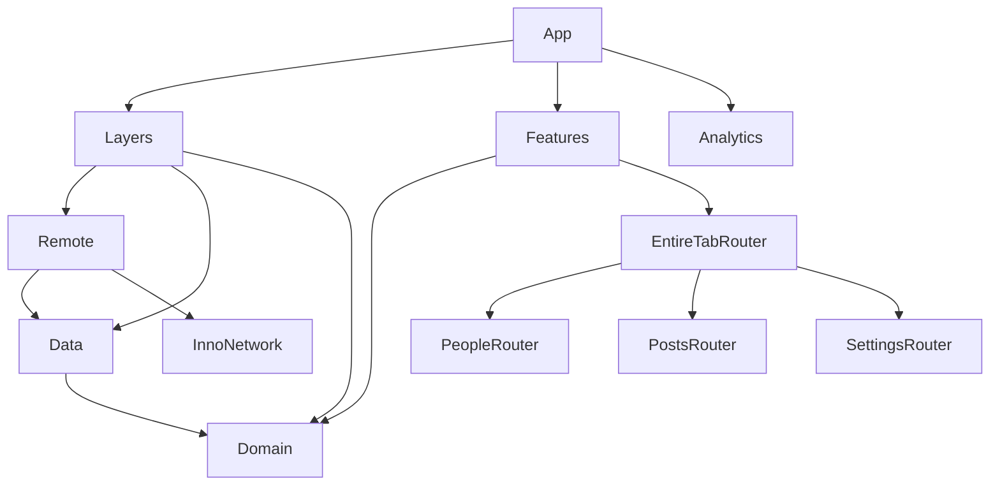

# InnoSample

[](https://github.com/InnoSquadCorp/InnoSample/actions/workflows/verify.yml)

[English](README.md) | [한국어](README.ko.md) | [Español](README.es.md) | [Deutsch](README.de.md) | [简体中文](README.zh-Hans.md) | [日本語](README.ja.md) | [Русский](README.ru.md)

公開リリースの **InnoDI、InnoFlow、InnoNetwork、InnoRouter** APIを組み合わせた、モジュール構成のSwiftUIアプリ兼開発用scaffoldです。3つの機能で、依存関係の組み立て、非同期ロード、型付きナビゲーション、機能間intent、ネイティブpresentationのライフサイクルを示します。

このREADMEはリポジトリ内の実装を説明します。[アーキテクチャレビュー](Docs/ArchitectureReview.md)には追加のAPI適用範囲と検証の境界を記録しています。7言語のREADMEは同じ例とコマンドを含みます。アプリUIの多言語化は別の作業です。

<!-- section:requirements -->
## 要件と依存関係

- **Xcode 27.1 / Swift 6.4**を使用するmacOS。プロジェクトの言語設定はSwift 6.3です。
- [.mise.toml](.mise.toml)で固定した **Tuist 4.202.5** とripgrep 15.1.0。このTuistバージョンはInnoNetworkのデフォルトpackage trait `Macros` を保持します。
- アプリ：**iOS/iPadOS 18+、macOS 15+**。同梱watch companion：**watchOS 11+**。
- 共通モジュールのmanifestではtvOS 18+とvisionOS 2+も宣言しています。アプリ全体のCIはiOS、watch companion、macOSを検証します。

| ライブラリ | 固定リリース | 役割 |
| --- | --- | --- |
| [InnoDI](https://github.com/InnoSquadCorp/InnoDI/tree/7.0.1) | 7.0.1 | Container、provider・overrideの生成、依存グラフ検証 |
| [InnoFlow](https://github.com/InnoSquadCorp/InnoFlow/tree/6.0.2) | 6.0.2 | State、action、phase、非同期effect、typed output |
| [InnoNetwork](https://github.com/InnoSquadCorp/InnoNetwork/tree/6.1.1) | 6.1.1 | Endpointマクロ、transport、認証、retry、HTTP cache |
| [InnoRouter](https://github.com/InnoSquadCorp/InnoRouter/tree/7.0.0) | 7.0.0 | Route、タブ、deep link、stack/split host、型付きpresentation結果 |

[依存関係helper](Tuist/ProjectDescriptionHelpers/Dependency/TargetDependency+.swift)でexact remote releaseを宣言し、各プロジェクトが必要なpackageを指定します。[Tuist/Package.swift](Tuist/Package.swift)には意図的にグローバル依存やlinkage overrideを置いていません。生成したproject・workspace・lockfileはGit管理対象外です。`make verify-versions` が生成グラフのrelease revisionとSwiftSyntax 604.0.0を検証します。

<!-- section:run -->
## アプリの実行

miseと使用するXcodeをインストールしてから実行します。

```bash
git clone https://github.com/InnoSquadCorp/InnoSample.git
cd InnoSample
mise install
make install-dependencies
make generate
make open
```

**InnoSampleApp** schemeとiOS SimulatorまたはMacを選択します。**InnoSampleWatchApp**は同梱watch targetです。サンプルmanifestでは署名を無効にしているため、実機への配布には独自の署名設定が必要です。

通常実行ではRemote経由でJSONPlaceholderを利用します。Debugの `--uitesting` 起動ではgenerated DI overrideでrepositoryを差し替え、実際のfeature・reducer・router構成を保持します。ネイティブUIテストはこの固定fixtureを使います。

<!-- section:features -->
## サンプルの機能

| 機能 | データ | 操作 |
| --- | --- | --- |
| People | `/users` | 一覧、詳細、Overview sheet、担当者のSettings詳細を開くintent |
| Posts | `/posts` | 一覧、詳細、Highlights sheet、狭い画面のstackと広い画面の2列split |
| Settings | `/todos` | 一覧、詳細、完了項目フィルター、Digest結果、People詳細を開くintent |
| EntireTab | 共有child coordinator | GeneratedタブID・destination、People ↔ Settingsとdeep linkの仲介 |

Generated resolverは `innosample` schemeと `host` hostを許可します。アプリをインストールした起動済みsimulatorで試せます。

```bash
xcrun simctl openurl booted 'innosample://host/people/1'
xcrun simctl openurl booted 'innosample://host/settings/1'
```

Watch companionは固定People snapshotをネイティブの一覧・詳細画面で表示し、Domainモデルを共有します。watchの同期とネットワークロードは現在の実装には含まれません。

<!-- section:architecture -->
## モジュールの境界

各モジュールは独自の `Project.swift` を持ち、[Workspace.swift](Workspace.swift)が全体を組み立てます。矢印はコンパイル時の依存方向です。実行時にはLayersがRemote → Data → Domainを組み立て、Featuresに `FeatureUseCaseContaining` を提供します。



| 境界 | 所有する責務 |
| --- | --- |
| App | Root container、analytics adapter、Layers/Features構成、ライフサイクル |
| Domain | Entity、repository protocol、共有repository上の具象・状態を持たない `callAsFunction()` use case |
| Data | Repository実装、remote data-source契約、DTO変換、データポリシー |
| Remote | Endpoint、decode、transportポリシー、Dataのremote契約の実装 |
| Layers | 構成専用。内部containerを公開せずfeature向けuse caseを提供 |
| Features | Domain use-case入力によるchild Router targetのroot構成 |
| Leaf Interface / Logic / UI / Router | 公開入力・出力 / 状態・effect / 描画・callback / route・presentation |
| Leaf Testing / Tests | Fixture・helper / 実行可能な回帰テスト |
| ThirdParties/Analytics | SDK wrapper例。Interface framework、static実装、テスト |
| Utils/SampleDesignSupport | Loading、error、metricなどの共有UIコンポーネント |

LogicはDomainとInnoFlowをimportし、SwiftUIとInnoRouterはUI/router境界に置きます。UIはinterface/model契約を使い、Domain、Data、Remote、InnoRouterを直接importしません。兄弟featureは互いのrouterをimportせずEntireTab経由でtyped intentを交換します。[LinkagePolicy](Docs/LinkagePolicy.md)にdynamic composition/interface frameworkとstatic実装targetを説明しています。

<!-- section:macros -->
## マクロの統合

### InnoDI：生成とライフサイクル

以下は[People container](Features/PeopleFeature/Router/Coordinator/PeopleFeatureContainer.swift)の全コードです。Generated初期化とshared providerでcoordinatorを保持します。

<!-- source:Features/PeopleFeature/Router/Coordinator/PeopleFeatureContainer.swift -->
```swift
import InnoDI
import PeopleFeatureInterface

@DIContainerRole(role: ContainerRole.local, mainActor: true)
public struct PeopleFeatureContainer {
    @Input
    public var input: PeopleFeatureInput

    @Provide(.shared, PeopleFeatureCoordinator.self, with: [\Self.input])
    public var coordinator: PeopleFeatureCoordinator
}
```

[AppContainer](App/Sources/AppContainer.swift)はroot役割の `@DIContainerRole`、on-demand analytics provider、key-path bindingと `featureRoot:` を持つ `@SubContainer` を使用します。アプリはgenerated root-view helperを呼び出します。Container targetに `InnoDIDAGValidationPlugin` を接続し、テストではgenerated override、prewarm、async providerの準備・retry・close、multibinding、`@GenerateMock` を検証します。アプリはInnoDIを直接使い、plain feature-root helperにInnoDISwiftUI hostは必要ありません。

### InnoFlow：状態とeffect

Production reducerは `@InnoFlow(phaseManaged: true, strictPhaseTotality: true)`、内部State/Action/Output、generated case pathを使うphase mapで定義します。[Settings reducer](Features/SettingsFeature/Logics/Reducer/SettingsFeatureReducer.swift)のこの部分は成功・失敗をactionへ戻し、進行中のロードを置き換えます。

<!-- source:Features/SettingsFeature/Logics/Reducer/SettingsFeatureReducer.swift -->
```swift
    private func loadTodos() -> ReducerEffect<Action, Output> {
        let loadTodos = dependencies.loadTodos

        return .perform(
            operation: { try await loadTodos() },
            success: Action.todosLoaded,
            failure: { error in
                .todosFailed((error as? LocalizedError)?.errorDescription ?? error.localizedDescription)
            }
        )
        .cancellable("settings-feature-load", cancelInFlight: true)
    }
```

Settingsは完了フィルターに `@BindableField` を使い、書き込み可能なobservable modelをUIの `@Bindable` bindingに接続します。Coordinatorはdispatch時に上限付きtyped outputをcaptureし、`for await` で消費してcaptureを終了します。Logicテストはexhaustive TestStore assertion、ManualTestClock、機密情報を伏せたinstrumentationを使います。

### InnoNetwork：endpointとポリシー

以下の[People endpoint](Layers/Remote/Sources/User/Requests/FetchUsersRequest.swift)全体はmethod/path/認証とprotocol witnessの生成を `@APIDefinition` に任せます。

<!-- source:Layers/Remote/Sources/User/Requests/FetchUsersRequest.swift -->
```swift
import Data
import InnoNetwork

@APIDefinition(method: .get, path: "/users", auth: .anonymous)
struct FetchUsersRequest: RemoteRequest {
    typealias APIResponse = [UserRemoteModel]

    var featureName: String { "People" }
}
```

[RemoteClientFactory](Layers/Remote/Sources/Infrastructure/RemoteClientFactory.swift)はbearer refresh/replayを `/todos` に限定し、上限付き指数retryと20秒timeoutを使用します。300秒cache-firstポリシー上にRFC 9111 cacheを適用し、persistent cacheの上限は25 MiB / 500件です。安定したmetadataでGET cacheを再利用します。Token rotationはサンプル実装であり、JSONPlaceholderに実際の認証サービスはありません。

### InnoRouter：契約の生成

[SampleTab](Features/EntireTabFeature/Router/Tab/SampleTab+InnoRouterTab.swift)は `@Router` と安定した `@TabItem(id:)` 宣言を使い、shellがgenerated catalogをnative TabViewで表示します。[SampleDeepLink](Features/EntireTabFeature/Router/DeepLink/SampleDeepLink.swift)は `@DeepLink` とorigin allowlistを使います。Leaf route enumはdestinationとtyped helperを生成します。

Router viewは `@EnvironmentRouter` で命令を送り、`@EnvironmentRouterState` でpresentation状態を読みます。Digestは `@PresentationResult(Bool.self)` を宣言します。明示的なCloseは値を返して1回acknowledgeし、ジェスチャー終了・キャンセル・拒否は別の結果です。テストは上限付きCodable snapshot、draft、revision/event、RouterTestStoreの完了も検証します。

<!-- section:navigation -->
## ナビゲーションの所有権とPostsの適応

共有EntireTab coordinatorがgeneratedタブ選択を所有します。各leafがstack/split hostを所有し、すべてのchild coordinator環境をタブdestinationより上で注入します。これにより、ネイティブnavigation containerの入れ子がタブ復帰時にchild pathを初期化する問題を防ぎます。

Postsは共有coordinatorに1つのconfigured RouterStoreを保持します。タブviewportの幅が **800 pt未満** ならRouterHost、それ以上なら一覧・詳細columnを持つRouterSplitHostを描画します。`replaceHost` は同じstoreの全詳細履歴を保持します。Presentation中は既存hostとdismissal handleを維持し、終了後に最後に要求されたlayoutを適用します。両方向の切り替え、タブ復帰、Highlights、Close、Backをテストします。

<!-- section:validation -->
## 検証

```bash
make verify-docs
make verify
make test-ui
make verify-ci
```

| コマンド | 範囲 |
| --- | --- |
| `make verify-docs` | 7言語のsection・コード・リンク整合、release表、原本コード例、大文字小文字を区別したローカルリンク |
| `make verify` | Install/generate、文書、resolved release、import境界、exact-release DI DAG、macOS 11 test suite、iOS + watch companionおよびmacOS build |
| `make test-ui` | 専用iPad mini simulatorで6件のnative UI回帰テスト |
| `make verify-ci` | 全 `make verify` gateの後に `make test-ui` |

個別target：`make test-domain`、`make test-data`、`make test-remote`、`make test-leaf-features`、`make test-layers`、`make test-features`、`make test-analytics`、`make test-app`、`make build-app`、`make build-macos`。

UI検証：People → Settings → PeopleとOverview、Posts選択・Highlights、タブ・compact/split切り替え後の詳細保持、両方の幅でHighlightsと詳細復帰、Settingsフィルター・Digestの1回acknowledge、acknowledgeなしのジェスチャー終了。

Selectorはインストール済みの互換iOS runtimeでiPad mini (A17 Pro)、次にiPad mini (6th generation)を優先します。テストタイマー前に起動を終え、管理したsimulatorは後でshutdownします。既存deviceやxcresult保存先も指定できます。

```bash
make test-ui SIMULATOR_ID=<simulator-udid>
UI_TEST_RUNTIME_VERSION=27.0 UI_TEST_RESULT_BUNDLE=/tmp/InnoSampleUI.xcresult make test-ui
```

[GitHub Actions](.github/workflows/verify.yml)はmain pushとPRに同じgateをXcode 27.1 / iOS 27.0で実行し、native UI結果をアップロードします。CLIのtrust-confirmation skip flagを使ってもマクロコンパイルとDAG検証は実行します。Fixture成功とunsigned buildはliveサーバー動作、実機配布、リリースを検証しません。

<!-- section:maintenance -->
## 保守と関連文書

APIやコマンドを変更したら7つのREADMEを同時に更新し、`make verify-docs` を実行します。Section ID、コードブロック、リンク先、release pin、原本コード例を比較します。翻訳本文も英語とともに管理します。

- [ArchitectureReview](Docs/ArchitectureReview.md)：API適用範囲、所有権の判断、日付付き検証証拠（韓国語）。
- [LinkagePolicy](Docs/LinkagePolicy.md)：Package productとdynamic/static linkage（韓国語）。
- [Tuist helpers](Tuist/ProjectDescriptionHelpers)：Target template、platform設定、依存関係、scheme。
- [Native UI tests](App/UITests/InnoSampleAppUITests.swift)：実行可能なアプリ単位のフロー。

選択型WebSocket/upload/download/OpenAPI/AWS/trust product、InnoStream、Protobuf、InnoBaseは現在のアプリの機能範囲外です。Router snapshotテストはアプリのディスク復元を意味しません。Window/immersive driverやinspectorも現在のアプリには含まれません。
