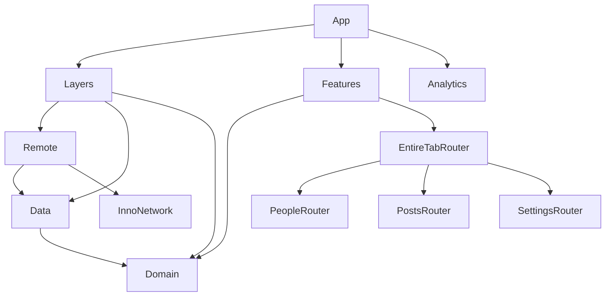

# InnoSample

[](https://github.com/InnoSquadCorp/InnoSample/actions/workflows/verify.yml)

[English](README.md) | [한국어](README.ko.md) | [Español](README.es.md) | [Deutsch](README.de.md) | [简体中文](README.zh-Hans.md) | [日本語](README.ja.md) | [Русский](README.ru.md)

배포된 **InnoDI, InnoFlow, InnoNetwork, InnoRouter** API를 함께 사용하는 모듈형 SwiftUI 앱이자 개발 시작용 scaffold입니다. 세 기능을 통해 의존성 조립, 비동기 로딩, 타입 기반 내비게이션, 기능 간 intent, native presentation의 수명을 보여줍니다.

이 README는 저장소의 실제 앱 구현을 설명합니다. [아키텍처 검토](Docs/ArchitectureReview.md)에는 추가 API 적용 범위와 검증 경계를 기록합니다. 7개 언어 README의 예제와 명령은 동일하며, 앱 UI의 다국어화는 별도 작업입니다.

<!-- section:requirements -->
## 요구 사항과 의존성

- **Xcode 27.1 / Swift 6.4**를 사용하는 macOS. 프로젝트 언어 설정은 Swift 6.3입니다.
- [.mise.toml](.mise.toml)에 고정한 **Tuist 4.202.5**, ripgrep 15.1.0. 이 Tuist 버전은 InnoNetwork의 기본 `Macros` package trait를 보존합니다.
- 앱: **iOS/iPadOS 18+, macOS 15+**. 함께 포함하는 watch companion: **watchOS 11+**.
- 공용 모듈 manifest에는 tvOS 18+, visionOS 2+도 선언되어 있습니다. 앱 전체 CI gate는 iOS, watch companion, macOS를 검증합니다.

| 라이브러리 | 고정 릴리스 | 책임 |
| --- | --- | --- |
| [InnoDI](https://github.com/InnoSquadCorp/InnoDI/tree/7.0.1) | 7.0.1 | 컨테이너, provider·override 생성, 의존 그래프 검증 |
| [InnoFlow](https://github.com/InnoSquadCorp/InnoFlow/tree/6.0.2) | 6.0.2 | 상태, action, phase, 비동기 effect, typed output |
| [InnoNetwork](https://github.com/InnoSquadCorp/InnoNetwork/tree/6.1.1) | 6.1.1 | Endpoint 매크로, transport, 인증, retry, HTTP cache |
| [InnoRouter](https://github.com/InnoSquadCorp/InnoRouter/tree/7.0.0) | 7.0.0 | Route, 탭, deep link, stack/split host, typed presentation 결과 |

[의존성 helper](Tuist/ProjectDescriptionHelpers/Dependency/TargetDependency+.swift)에 exact remote release를 선언하고 각 프로젝트가 소비할 package를 지정합니다. [Tuist/Package.swift](Tuist/Package.swift)의 전역 의존성과 linkage override는 의도적으로 비워 둡니다. 생성된 프로젝트·workspace·lockfile은 Git에서 제외하며, `make verify-versions`가 생성된 그래프의 release revision과 SwiftSyntax 604.0.0을 확인합니다.

<!-- section:run -->
## 앱 실행

mise와 사용할 Xcode를 먼저 설치한 뒤 실행합니다.

```bash
git clone https://github.com/InnoSquadCorp/InnoSample.git
cd InnoSample
mise install
make install-dependencies
make generate
make open
```

**InnoSampleApp** scheme에서 iOS Simulator나 Mac을 선택합니다. **InnoSampleWatchApp**은 앱에 포함되는 watch 타깃입니다. 샘플 manifest는 signing을 비활성화하므로 실기기 배포에는 자체 signing 설정이 필요합니다.

일반 실행은 Remote를 통해 JSONPlaceholder를 사용합니다. Debug에서 `--uitesting`으로 실행하면 generated DI override로 repository를 교체하며 실제 feature·reducer·router 조립은 유지합니다. Native UI 테스트는 이 고정 fixture 경로를 사용합니다.

<!-- section:features -->
## 샘플 기능

| 기능 | 데이터 | 동작 |
| --- | --- | --- |
| People | `/users` | 목록, 상세, Overview sheet, 담당자의 Settings 상세를 여는 intent |
| Posts | `/posts` | 목록, 상세, Highlights sheet, 좁은 화면의 stack과 넓은 화면의 두 column split |
| Settings | `/todos` | 목록, 상세, 완료 항목 필터, Digest 결과, People 상세를 여는 intent |
| EntireTab | 공유 child coordinator | Generated 탭 ID·destination, People ↔ Settings와 deep link 중재 |

Generated resolver는 `innosample` scheme과 `host` host를 허용합니다. 앱이 설치된 부팅 상태의 simulator에서 아래 링크를 실행할 수 있습니다.

```bash
xcrun simctl openurl booted 'innosample://host/people/1'
xcrun simctl openurl booted 'innosample://host/settings/1'
```

Watch companion은 고정 People snapshot을 native 목록·상세 화면으로 보여주며 Domain 모델을 공유합니다. 현재 watch 구현에는 동기화와 네트워크 로딩이 포함되어 있지 않습니다.

<!-- section:architecture -->
## 모듈 경계

각 모듈은 자체 `Project.swift`를 가지며 [Workspace.swift](Workspace.swift)가 전체를 조립합니다. 화살표는 컴파일 의존 방향입니다. 런타임에서는 Layers가 Remote → Data → Domain을 조립해 `FeatureUseCaseContaining`을 Features에 제공합니다.



| 경계 | 소유 책임 |
| --- | --- |
| App | Root container, analytics adapter, Layers/Features 조립, 수명 |
| Domain | Entity, repository protocol, shared repository 위의 concrete stateless `callAsFunction()` use case |
| Data | Repository 구현, remote data-source 계약, DTO 매핑, 데이터 정책 |
| Remote | Endpoint, decode, transport 정책, Data의 remote 계약 구현 |
| Layers | 조립 전용. 내부 container를 노출하지 않고 feature용 use case 제공 |
| Features | Domain use-case 입력으로 child Router 타깃을 조립하는 root |
| Leaf Interface / Logic / UI / Router | 공개 입력·출력 / 상태·effect / 렌더링·callback / route·presentation |
| Leaf Testing / Tests | Fixture·helper / 실행 가능한 회귀 검증 |
| ThirdParties/Analytics | SDK wrapper 예시. Interface framework, static 구현, 테스트 |
| Utils/SampleDesignSupport | 공용 loading, error, metric 등 UI 컴포넌트 |

Logic은 Domain과 InnoFlow를 import하고 SwiftUI와 InnoRouter는 UI/router 경계에 둡니다. UI는 interface/model 계약을 소비하며 Domain, Data, Remote, InnoRouter를 직접 import하지 않습니다. 형제 feature는 서로의 router를 import하는 대신 EntireTab을 통해 typed intent를 전달합니다. [LinkagePolicy](Docs/LinkagePolicy.md)에 dynamic composition/interface framework와 static 구현 타깃을 설명합니다.

<!-- section:macros -->
## 매크로 통합

### InnoDI: 생성과 수명

아래 [People container](Features/PeopleFeature/Router/Coordinator/PeopleFeatureContainer.swift)의 전체 코드는 generated 초기화와 shared provider로 coordinator를 유지합니다.

<!-- source:Features/PeopleFeature/Router/Coordinator/PeopleFeatureContainer.swift -->
```swift
import InnoDI
import PeopleFeatureInterface

@DIContainerRole(role: ContainerRole.local, mainActor: true)
public struct PeopleFeatureContainer {
    @Input
    public var input: PeopleFeatureInput

    @Provide(.shared, PeopleFeatureCoordinator.self, with: [\Self.input])
    public var coordinator: PeopleFeatureCoordinator
}
```

[AppContainer](App/Sources/AppContainer.swift)는 root 역할의 `@DIContainerRole`, on-demand analytics provider, key-path binding과 `featureRoot:`를 가진 `@SubContainer`를 사용합니다. 앱은 generated root-view helper를 호출합니다. Container 타깃에는 `InnoDIDAGValidationPlugin`을 연결하고, 테스트에서 generated override, prewarm, async provider 준비·retry·close, multibinding, `@GenerateMock`을 검증합니다. 앱은 InnoDI를 직접 소비하며 plain feature-root helper에 InnoDISwiftUI host가 필요하지 않습니다.

### InnoFlow: 상태와 effect

Production reducer는 `@InnoFlow(phaseManaged: true, strictPhaseTotality: true)`, 내부 State/Action/Output, generated case path를 사용하는 phase map으로 작성합니다. [Settings reducer](Features/SettingsFeature/Logics/Reducer/SettingsFeatureReducer.swift)의 이 부분은 완료·실패를 action으로 돌려보내고 진행 중인 로딩을 교체합니다.

<!-- source:Features/SettingsFeature/Logics/Reducer/SettingsFeatureReducer.swift -->
```swift
    private func loadTodos() -> ReducerEffect<Action, Output> {
        let loadTodos = dependencies.loadTodos

        return .perform(
            operation: { try await loadTodos() },
            success: Action.todosLoaded,
            failure: { error in
                .todosFailed((error as? LocalizedError)?.errorDescription ?? error.localizedDescription)
            }
        )
        .cancellable("settings-feature-load", cancelInFlight: true)
    }
```

Settings는 완료 필터에 `@BindableField`를 사용하고 쓰기 가능한 observable model을 UI의 `@Bindable` binding에 연결합니다. Feature model은 dispatch 시 bounded typed output을 capture하고 `for await`로 소비한 뒤 capture를 종료합니다. Logic 테스트는 exhaustive TestStore assertion, ManualTestClock, 민감 정보가 가려진 instrumentation을 사용합니다.

### InnoNetwork: endpoint와 정책

아래 [People endpoint](Layers/Remote/Sources/User/Requests/FetchUsersRequest.swift)의 전체 코드는 method/path/인증, protocol witness 생성을 `@APIDefinition`에 맡깁니다.

<!-- source:Layers/Remote/Sources/User/Requests/FetchUsersRequest.swift -->
```swift
import Data
import InnoNetwork

@APIDefinition(method: .get, path: "/users", auth: .anonymous)
struct FetchUsersRequest: RemoteRequest {
    typealias APIResponse = [UserRemoteModel]

    var featureName: String { "People" }
}
```

[RemoteClientFactory](Layers/Remote/Sources/Infrastructure/RemoteClientFactory.swift)는 bearer refresh/replay를 `/todos`에 한정하고 제한된 지수 backoff retry와 20초 timeout을 사용합니다. 300초 cache-first 정책 위에 RFC 9111 cache를 적용하며 persistent cache 한도는 25 MiB / 500개입니다. 안정적인 metadata로 GET cache를 재사용합니다. Token rotation은 샘플 구현이며 JSONPlaceholder에는 실제 인증 서비스가 없습니다.

### InnoRouter: 계약 생성

[SampleTab](Features/EntireTabFeature/Router/Tab/SampleTab+InnoRouterTab.swift)은 `@Router`와 안정적인 `@TabItem(id:)` 선언을 사용하고 shell은 generated catalog를 native TabView로 렌더링합니다. [SampleDeepLink](Features/EntireTabFeature/Router/DeepLink/SampleDeepLink.swift)는 `@DeepLink`와 origin allowlist를 사용합니다. Leaf route enum은 destination과 typed helper를 생성합니다.

Router view는 `@EnvironmentRouter`로 명령을 보내고 `@EnvironmentRouterState`로 presentation 상태를 읽습니다. Digest는 `@PresentationResult(Bool.self)`를 선언합니다. 명시적 Close는 값을 반환해 한 번 acknowledge하고 제스처 종료·취소·거절은 별도 결과로 처리합니다. 테스트는 크기가 제한된 Codable snapshot, draft, revision/event, RouterTestStore 완료도 검증합니다.

<!-- section:navigation -->
## 내비게이션 소유권과 Posts 화면 전환

공유 EntireTab coordinator가 generated 탭 선택을 소유합니다. 각 leaf가 stack/split host를 소유하며 child coordinator 환경은 탭 destination보다 위에서 주입합니다. 이 구조는 native navigation container가 중첩되어 탭 복귀 시 child path를 초기화하는 문제를 방지합니다.

Posts는 공유 coordinator에 하나의 configured RouterStore를 유지합니다. 탭 viewport 너비가 **800 pt 미만**이면 RouterHost, 그 이상이면 목록·상세 column을 가진 RouterSplitHost를 렌더링합니다. `replaceHost`는 같은 store의 전체 상세 이력을 유지합니다. Presentation이 활성화된 동안 기존 host와 dismissal handle을 보존하고 닫힌 뒤 마지막으로 요청한 layout을 적용합니다. 양방향 전환, 탭 복귀, Highlights, Close, Back을 테스트합니다.

<!-- section:validation -->
## 검증

```bash
make verify-docs
make verify
make test-ui
make verify-ci
```

| 명령 | 범위 |
| --- | --- |
| `make verify-docs` | 7개 언어의 section·코드·링크 일치, release 표, 원본 코드 예제, 대소문자를 구분한 로컬 링크 |
| `make verify` | Install/generate, 문서, resolved release, import 경계, exact-release DI DAG, macOS 11개 test suite, iOS + watch companion 및 macOS 빌드 |
| `make test-ui` | 전용 iPad mini simulator에서 native UI 회귀 테스트 6개 |
| `make verify-ci` | 전체 `make verify` gate 후 `make test-ui` |

개별 타깃: `make test-domain`, `make test-data`, `make test-remote`, `make test-leaf-features`, `make test-layers`, `make test-features`, `make test-analytics`, `make test-app`, `make build-app`, `make build-macos`.

UI 검증: People → Settings → People과 Overview, Posts 선택·Highlights, 탭·compact/split 전환 후 상세 유지, 양방향 너비 변경 중 Highlights와 상세 복귀, Settings 필터·Digest 1회 acknowledge, acknowledge 없는 제스처 종료.

Selector는 설치된 호환 iOS runtime에서 iPad mini (A17 Pro), 다음으로 iPad mini (6th generation)를 선택합니다. 테스트 타이머 전에 부팅을 끝내고 직접 관리한 simulator는 종료 후 shutdown합니다. 기존 기기나 xcresult 저장 경로를 지정할 수도 있습니다.

```bash
make test-ui SIMULATOR_ID=<simulator-udid>
UI_TEST_RUNTIME_VERSION=27.0 UI_TEST_RESULT_BUNDLE=/tmp/InnoSampleUI.xcresult make test-ui
```

[GitHub Actions](.github/workflows/verify.yml)는 main push와 PR에 같은 gate를 실행합니다. Xcode 27.1 / iOS 27.0을 사용하고 native UI 결과를 업로드합니다. CLI의 trust-confirmation skip flag를 사용해도 매크로 컴파일과 DAG 검증은 실행합니다. Fixture 통과와 unsigned 빌드는 live 서버 동작, 실기기 배포, 릴리스를 검증하지 않습니다.

<!-- section:maintenance -->
## 유지 관리와 관련 문서

API나 명령을 바꾸면 7개 README를 함께 수정하고 `make verify-docs`를 실행합니다. 이 검사는 section ID, 코드 블록, 링크 대상, release pin, 원본 코드 예제를 비교합니다. 번역 본문도 영어 원문과 함께 관리합니다.

- [ArchitectureReview](Docs/ArchitectureReview.md): API 적용 범위, 소유권 결정, 날짜별 검증 증거. 한국어 문서입니다.
- [LinkagePolicy](Docs/LinkagePolicy.md): Package product와 dynamic/static linkage. 한국어 문서입니다.
- [Tuist helpers](Tuist/ProjectDescriptionHelpers): 타깃 template, platform 설정, 의존성, scheme.
- [Native UI tests](App/UITests/InnoSampleAppUITests.swift): 실행 가능한 앱 단위 흐름.

선택형 WebSocket/upload/download/OpenAPI/AWS/trust product, InnoStream, Protobuf, InnoBase는 현재 앱의 소비 기능에 포함되지 않습니다. Router snapshot 테스트가 앱의 디스크 복원을 의미하지 않으며 window/immersive driver와 inspector도 현재 앱에는 포함되어 있지 않습니다.
