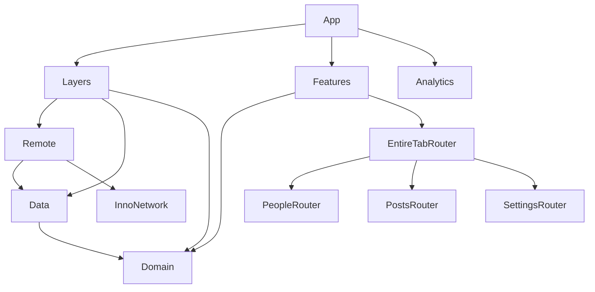

# InnoSample

[](https://github.com/InnoSquadCorp/InnoSample/actions/workflows/verify.yml)

[English](README.md) | [한국어](README.ko.md) | [Español](README.es.md) | [Deutsch](README.de.md) | [简体中文](README.zh-Hans.md) | [日本語](README.ja.md) | [Русский](README.ru.md)

A modular SwiftUI app and starting scaffold combining the released **InnoDI, InnoFlow, InnoNetwork and InnoRouter** APIs. Three features demonstrate dependency composition, asynchronous loading, typed navigation, cross-feature intents and native presentation lifetimes.

This README describes the checked-in app. The [architecture review](Docs/ArchitectureReview.md) records additional API coverage and validation boundaries. All seven READMEs contain the same examples and commands; application UI localization is a separate concern.

<!-- section:requirements -->
## Requirements and dependencies

- macOS with **Xcode 27.1 / Swift 6.4**; project language setting: Swift 6.3.
- **Tuist 4.202.5** and ripgrep 15.1.0, pinned in [.mise.toml](.mise.toml). This Tuist version preserves InnoNetwork's default `Macros` package trait.
- App: **iOS/iPadOS 18+, macOS 15+**. Bundled watch companion: **watchOS 11+**.
- Shared module manifests also declare tvOS 18+ and visionOS 2+. The full application CI gate covers iOS, its watch companion and macOS.

| Library | Exact release | Responsibility |
| --- | --- | --- |
| [InnoDI](https://github.com/InnoSquadCorp/InnoDI/tree/7.0.1) | 7.0.1 | Containers, generated providers/overrides and dependency-graph validation |
| [InnoFlow](https://github.com/InnoSquadCorp/InnoFlow/tree/6.0.2) | 6.0.2 | State, actions, phases, asynchronous effects and typed outputs |
| [InnoNetwork](https://github.com/InnoSquadCorp/InnoNetwork/tree/6.1.1) | 6.1.1 | Endpoint macros, transport, authentication, retry and HTTP cache |
| [InnoRouter](https://github.com/InnoSquadCorp/InnoRouter/tree/7.0.0) | 7.0.0 | Routes, tabs, deep links, stack/split hosts and typed presentation results |

The [dependency helper](Tuist/ProjectDescriptionHelpers/Dependency/TargetDependency+.swift) declares exact remote releases. Each project lists its consumed packages. [Tuist/Package.swift](Tuist/Package.swift) deliberately has no global package dependencies or linkage overrides. Generated projects, workspaces and lockfiles are ignored; `make verify-versions` checks release revisions and SwiftSyntax 604.0.0 in the generated graph.

<!-- section:run -->
## Run the app

Install mise and the selected Xcode first, then:

```bash
git clone https://github.com/InnoSquadCorp/InnoSample.git
cd InnoSample
mise install
make install-dependencies
make generate
make open
```

Select the **InnoSampleApp** scheme and an iOS Simulator or your Mac. **InnoSampleWatchApp** is the bundled watch target. Signing is disabled in the sample manifest; physical-device deployment needs your own signing configuration.

The normal app uses JSONPlaceholder through Remote. Debug launches with `--uitesting` replace repositories through generated DI overrides while retaining the actual feature, reducer and router assembly. Native UI tests use this deterministic fixture path.

<!-- section:features -->
## Explore the sample

| Feature | Data | Interactions |
| --- | --- | --- |
| People | `/users` | List, detail, Overview sheet, intent to open an assignee's Settings detail |
| Posts | `/posts` | List, detail, Highlights sheet; compact stack and wide two-column split |
| Settings | `/todos` | List, detail, completed-only filter, Digest result, intent to open People detail |
| EntireTab | Shared child coordinators | Generated tab identities/destinations; mediates People ↔ Settings and deep links |

The generated resolver accepts the `innosample` scheme and `host` host. Try these links with the app installed on a booted simulator:

```bash
xcrun simctl openurl booted 'innosample://host/people/1'
xcrun simctl openurl booted 'innosample://host/settings/1'
```

The watch companion displays a fixed People snapshot with native list/detail navigation and shares Domain models. Watch synchronization and network loading are outside its current implementation.

<!-- section:architecture -->
## Module boundaries

Each module has its own `Project.swift`; [Workspace.swift](Workspace.swift) assembles them. Arrows show compile-time dependencies. At runtime, Layers composes Remote → Data → Domain and exposes `FeatureUseCaseContaining` to Features.



| Boundary | Ownership |
| --- | --- |
| App | Root container, analytics adapter, Layers/Features assembly and lifecycle |
| Domain | Entities, repository protocols and concrete stateless `callAsFunction()` use cases over shared repositories |
| Data | Repository implementations, remote data-source contracts, DTO mapping and data policies |
| Remote | Endpoints, decoding, transport policy and implementations of Data's remote contracts |
| Layers | Composition only; feature-facing use cases without exposing internal containers |
| Features | Root composition of child Router targets through Domain use-case inputs |
| Leaf Interface / Logic / UI / Router | Public inputs/outputs / state and effects / rendering and callbacks / routes and presentations |
| Leaf Testing / Tests | Fixtures and helpers / executable regression coverage |
| ThirdParties/Analytics | SDK-wrapper example: interface framework, static implementation and tests |
| Utils/SampleDesignSupport | Shared loading, error, metric and other UI components |

Logic imports Domain and InnoFlow, keeping SwiftUI and InnoRouter at the UI/router boundary. UI consumes interface/model contracts without directly importing Domain, Data, Remote or InnoRouter. Sibling features exchange typed intents through EntireTab rather than importing each other's routers. [LinkagePolicy](Docs/LinkagePolicy.md) explains dynamic composition/interface frameworks and static implementation targets.

<!-- section:macros -->
## Macro integration

### InnoDI: construction and lifetime

The complete [People container](Features/PeopleFeature/Router/Coordinator/PeopleFeatureContainer.swift) uses generated initialization and a shared provider to retain its coordinator:

<!-- source:Features/PeopleFeature/Router/Coordinator/PeopleFeatureContainer.swift -->
```swift
import InnoDI
import PeopleFeatureInterface

@DIContainerRole(role: ContainerRole.local, mainActor: true)
public struct PeopleFeatureContainer {
    @Input
    public var input: PeopleFeatureInput

    @Provide(.shared, PeopleFeatureCoordinator.self, with: [\Self.input])
    public var coordinator: PeopleFeatureCoordinator
}
```

[AppContainer](App/Sources/AppContainer.swift) uses root-role `@DIContainerRole`, an on-demand analytics provider and `@SubContainer` with key-path bindings and `featureRoot:`. The app calls the generated root-view helper. Container targets attach `InnoDIDAGValidationPlugin`; tests cover generated overrides, prewarming, async-provider preparation/retry/close, multibindings and `@GenerateMock`. The app consumes InnoDI directly; its plain feature-root helper needs no InnoDISwiftUI host.

### InnoFlow: state and effects

Production reducers use `@InnoFlow(phaseManaged: true, strictPhaseTotality: true)`, nested State/Action/Output and phase maps with generated case paths. This [Settings reducer](Features/SettingsFeature/Logics/Reducer/SettingsFeatureReducer.swift) excerpt maps success/failure to actions and replaces an in-flight load:

<!-- source:Features/SettingsFeature/Logics/Reducer/SettingsFeatureReducer.swift -->
```swift
    private func loadTodos() -> ReducerEffect<Action, Output> {
        let loadTodos = dependencies.loadTodos

        return .perform(
            operation: { try await loadTodos() },
            success: Action.todosLoaded,
            failure: { error in
                .todosFailed((error as? LocalizedError)?.errorDescription ?? error.localizedDescription)
            }
        )
        .cancellable("settings-feature-load", cancelInFlight: true)
    }
```

Settings uses `@BindableField` for the completed filter and a writable observable model for UI `@Bindable` bindings. Coordinators capture bounded typed outputs at dispatch, consume them with `for await` and finish the capture. Logic tests use exhaustive TestStore assertions, ManualTestClock and redacted instrumentation.

### InnoNetwork: endpoints and policy

The complete [People endpoint](Layers/Remote/Sources/User/Requests/FetchUsersRequest.swift) delegates method/path/authentication and protocol-witness generation to `@APIDefinition`:

<!-- source:Layers/Remote/Sources/User/Requests/FetchUsersRequest.swift -->
```swift
import Data
import InnoNetwork

@APIDefinition(method: .get, path: "/users", auth: .anonymous)
struct FetchUsersRequest: RemoteRequest {
    typealias APIResponse = [UserRemoteModel]

    var featureName: String { "People" }
}
```

[RemoteClientFactory](Layers/Remote/Sources/Infrastructure/RemoteClientFactory.swift) confines bearer refresh/replay to `/todos`, uses bounded exponential retry and a 20-second timeout, and opts into RFC 9111 caching over a 300-second cache-first policy. Persistent cache is limited to 25 MiB / 500 entries. Stable metadata preserves GET cache reuse. Token rotation is a sample implementation; JSONPlaceholder has no real authentication service.

### InnoRouter: generated contracts

[SampleTab](Features/EntireTabFeature/Router/Tab/SampleTab+InnoRouterTab.swift) combines `@Router` with stable `@TabItem(id:)` declarations; the shell consumes its generated catalog in a native TabView. [SampleDeepLink](Features/EntireTabFeature/Router/DeepLink/SampleDeepLink.swift) uses `@DeepLink` and an origin allowlist. Leaf route enums generate destinations and typed helpers.

Router views issue commands with `@EnvironmentRouter` and read presentation state with `@EnvironmentRouterState`. Digest declares `@PresentationResult(Bool.self)`: explicit Close returns a value and acknowledges once; gesture dismissal, cancellation and rejection are distinct outcomes. Tests also cover bounded Codable snapshots, drafts, revision/events and RouterTestStore completion.

<!-- section:navigation -->
## Navigation ownership and adaptive Posts

The shared EntireTab coordinator owns generated tab selection. Each leaf owns its stack/split host; all child coordinator environments are injected above tab destinations. This avoids nested native navigation containers resetting a child path on tab return.

Posts retains one configured RouterStore in its shared coordinator. The tab viewport observes width: below **800 pt** it renders RouterHost; at or above that width it renders RouterSplitHost with list/detail columns. `replaceHost` preserves the full detail history in the same store. While a presentation is active, the existing host and dismissal handle survive; the latest requested layout applies after dismissal. Tests cover both directions, tab return, Highlights, Close and Back.

<!-- section:validation -->
## Validation

```bash
make verify-docs
make verify
make test-ui
make verify-ci
```

| Command | Scope |
| --- | --- |
| `make verify-docs` | Seven-language section/code/link parity, release table, source excerpts and case-sensitive local links |
| `make verify` | Install/generate, docs, resolved releases, import boundaries, exact-release DI DAG, 11 macOS test suites, iOS + watch companion build and macOS build |
| `make test-ui` | Six native UI regressions on a dedicated iPad mini simulator |
| `make verify-ci` | Full `make verify` gate followed by `make test-ui` |

Individual targets: `make test-domain`, `make test-data`, `make test-remote`, `make test-leaf-features`, `make test-layers`, `make test-features`, `make test-analytics`, `make test-app`, `make build-app`, `make build-macos`.

UI coverage: People → Settings → People and Overview; Posts selection/Highlights; detail survival across tab and compact/split transitions; Highlights across both widths and return to detail; Settings filter and one Digest acknowledgement; gesture dismissal without acknowledgement.

The selector prefers iPad mini (A17 Pro), then iPad mini (6th generation), on an installed compatible iOS runtime. It completes boot before the test timer starts and shuts down its owned simulator afterward. To use an existing device or retain an xcresult:

```bash
make test-ui SIMULATOR_ID=<simulator-udid>
UI_TEST_RUNTIME_VERSION=27.0 UI_TEST_RESULT_BUNDLE=/tmp/InnoSampleUI.xcresult make test-ui
```

[GitHub Actions](.github/workflows/verify.yml) runs the same gate on main pushes and pull requests with Xcode 27.1 / iOS 27.0, and uploads native UI results. CLI trust-confirmation skip flags retain macro compilation and DAG validation. Fixture success and unsigned builds do not establish live-server behavior, device deployment or a release.

<!-- section:maintenance -->
## Maintenance and further reading

Update all seven READMEs together when changing APIs or commands and run `make verify-docs`. It compares section IDs, code blocks, link destinations, release pins and source excerpts. Translated prose is maintained alongside English.

- [ArchitectureReview](Docs/ArchitectureReview.md): API coverage, ownership decisions and dated validation evidence (Korean).
- [LinkagePolicy](Docs/LinkagePolicy.md): package products and dynamic/static linkage (Korean).
- [Tuist helpers](Tuist/ProjectDescriptionHelpers): target templates, platform settings, dependencies and schemes.
- [Native UI tests](App/UITests/InnoSampleAppUITests.swift): executable app-level flows.

Optional WebSocket/upload/download/OpenAPI/AWS/trust products, InnoStream, Protobuf and InnoBase are outside this app's consumed feature set. Router snapshot tests do not imply app-level disk restoration; window/immersive drivers and an inspector are also outside the current app.
