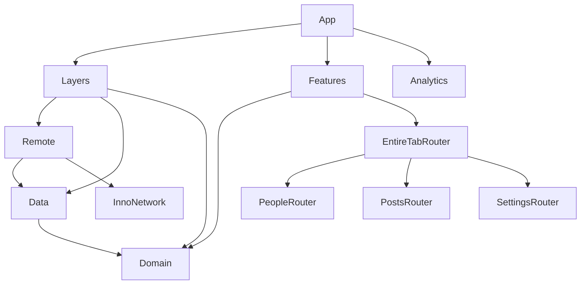

# InnoSample

[](https://github.com/InnoSquadCorp/InnoSample/actions/workflows/verify.yml)

[English](README.md) | [한국어](README.ko.md) | [Español](README.es.md) | [Deutsch](README.de.md) | [简体中文](README.zh-Hans.md) | [日本語](README.ja.md) | [Русский](README.ru.md)

Модульное приложение SwiftUI и основа для новых проектов на опубликованных API **InnoDI, InnoFlow, InnoNetwork и InnoRouter**. Три функции демонстрируют сборку зависимостей, асинхронную загрузку, типизированную навигацию, намерения между функциями и жизненный цикл нативных представлений.

README описывает приложение в репозитории. [Обзор архитектуры](Docs/ArchitectureReview.md) фиксирует дополнительное покрытие API и границы проверки. Все семь README содержат одинаковые примеры и команды; локализация интерфейса приложения — отдельная задача.

<!-- section:requirements -->
## Требования и зависимости

- macOS с **Xcode 27.1 / Swift 6.4**; языковой режим проекта — Swift 6.3.
- **Tuist 4.202.5** и ripgrep 15.1.0 закреплены в [.mise.toml](.mise.toml). Эта версия Tuist сохраняет стандартный package trait `Macros` в InnoNetwork.
- Приложение: **iOS/iPadOS 18+, macOS 15+**. Встроенное приложение-компаньон для часов: **watchOS 11+**.
- Манифесты общих модулей также объявляют tvOS 18+ и visionOS 2+. Полная проверка приложения в CI охватывает iOS, приложение для часов и macOS.

| Библиотека | Точная версия | Ответственность |
| --- | --- | --- |
| [InnoDI](https://github.com/InnoSquadCorp/InnoDI/tree/7.0.2) | 7.0.2 | Контейнеры, генерация provider/override, проверка графа зависимостей |
| [InnoFlow](https://github.com/InnoSquadCorp/InnoFlow/tree/6.0.2) | 6.0.2 | Состояние, действия, фазы, асинхронные эффекты и типизированные outputs |
| [InnoNetwork](https://github.com/InnoSquadCorp/InnoNetwork/tree/6.1.1) | 6.1.1 | Макросы endpoint, транспорт, аутентификация, повторы и HTTP-кеш |
| [InnoRouter](https://github.com/InnoSquadCorp/InnoRouter/tree/7.0.0) | 7.0.0 | Маршруты, вкладки, deep links, stack/split hosts и типизированные результаты представлений |

[Helper зависимостей](Tuist/ProjectDescriptionHelpers/Dependency/TargetDependency+.swift) объявляет точные удалённые релизы. Каждый проект перечисляет используемые пакеты. В [Tuist/Package.swift](Tuist/Package.swift) намеренно нет глобальных зависимостей или linkage overrides. Сгенерированные проекты, workspaces и lockfiles исключены из Git; `make verify-versions` проверяет ревизии релизов и SwiftSyntax 604.0.0 в сгенерированном графе.

<!-- section:run -->
## Запуск приложения

Сначала установите mise и выбранный Xcode, затем выполните:

```bash
git clone https://github.com/InnoSquadCorp/InnoSample.git
cd InnoSample
mise install
make install-dependencies
make generate
make open
```

Выберите схему **InnoSampleApp** и iOS Simulator либо Mac. **InnoSampleWatchApp** — встроенный target часов. Подпись отключена в манифесте примера; для установки на физическое устройство нужна собственная настройка подписи.

Обычный запуск использует JSONPlaceholder через Remote. В Debug параметр `--uitesting` заменяет репозитории с помощью сгенерированных DI overrides, сохраняя настоящую сборку feature, reducer и router. Нативные UI-тесты используют эти детерминированные fixtures.

<!-- section:features -->
## Функции примера

| Функция | Данные | Взаимодействия |
| --- | --- | --- |
| People | `/users` | Список, детали, лист Overview, намерение открыть Settings для ответственного |
| Posts | `/posts` | Список, детали, лист Highlights; компактный stack и широкий split из двух колонок |
| Settings | `/todos` | Список, детали, фильтр завершённых, результат Digest, намерение открыть People |
| EntireTab | Общие дочерние coordinators | Сгенерированные ID/назначения вкладок; посредник для People ↔ Settings и deep links |

Сгенерированный resolver принимает схему `innosample` и host `host`. Попробуйте ссылки на запущенном симуляторе с установленным приложением:

```bash
xcrun simctl openurl booted 'innosample://host/people/1'
xcrun simctl openurl booted 'innosample://host/settings/1'
```

Приложение для часов показывает фиксированный снимок People с нативной навигацией списка/деталей и общими моделями Domain. Синхронизация и сетевая загрузка на часах не входят в текущую реализацию.

<!-- section:architecture -->
## Границы модулей

У каждого модуля есть собственный `Project.swift`; [Workspace.swift](Workspace.swift) объединяет их. Стрелки показывают зависимости компиляции. Во время исполнения Layers собирает Remote → Data → Domain и предоставляет Features контракт `FeatureUseCaseContaining`.



| Граница | Ответственность |
| --- | --- |
| App | Корневой контейнер, адаптер аналитики, сборка Layers/Features и жизненный цикл |
| Domain | Сущности, протоколы репозиториев и конкретные use cases без состояния с `callAsFunction()` поверх общих репозиториев |
| Data | Реализации репозиториев, контракты удалённых источников, преобразование DTO и политики данных |
| Remote | Endpoints, декодирование, транспортная политика и реализации удалённых контрактов Data |
| Layers | Только сборка; use cases для функций без раскрытия внутренних контейнеров |
| Features | Корневая сборка дочерних Router targets через входные use cases Domain |
| Leaf Interface / Logic / UI / Router | Публичные входы/выходы / состояние и эффекты / отображение и callbacks / маршруты и представления |
| Leaf Testing / Tests | Fixtures и helpers / исполняемые регрессионные проверки |
| ThirdParties/Analytics | Пример SDK-wrapper: framework интерфейса, статическая реализация и тесты |
| Utils/SampleDesignSupport | Общие компоненты загрузки, ошибок, метрик и другого UI |

Logic импортирует Domain и InnoFlow, оставляя SwiftUI и InnoRouter на границе UI/router. UI использует контракты интерфейса/модели без прямого импорта Domain, Data, Remote или InnoRouter. Соседние функции обмениваются типизированными намерениями через EntireTab, не импортируя роутеры друг друга. [LinkagePolicy](Docs/LinkagePolicy.md) описывает динамические frameworks композиции/интерфейсов и статические targets реализации.

<!-- section:macros -->
## Интеграция макросов

### InnoDI: создание и жизненный цикл

Полный [контейнер People](Features/PeopleFeature/Router/Coordinator/PeopleFeatureContainer.swift) сохраняет coordinator через сгенерированный инициализатор и общий provider:

<!-- source:Features/PeopleFeature/Router/Coordinator/PeopleFeatureContainer.swift -->
```swift
import InnoDI
import PeopleFeatureInterface

@DIContainerRole(role: ContainerRole.local, mainActor: true)
public struct PeopleFeatureContainer {
    @Input
    public var input: PeopleFeatureInput

    @Provide(.shared, PeopleFeatureCoordinator.self, with: [\Self.input])
    public var coordinator: PeopleFeatureCoordinator
}
```

[AppContainer](App/Sources/AppContainer.swift) использует `@DIContainerRole` с ролью root, analytics provider по запросу и `@SubContainer` с key-path bindings и `featureRoot:`. Приложение вызывает сгенерированный helper корневого view. Targets контейнеров подключают `InnoDIDAGValidationPlugin`; тесты проверяют сгенерированные overrides, prewarming, подготовку/повтор/закрытие async providers, multibindings и `@GenerateMock`. Приложение использует InnoDI напрямую; обычному feature-root helper не нужен host InnoDISwiftUI.

### InnoFlow: состояние и эффекты

Production reducers используют `@InnoFlow(phaseManaged: true, strictPhaseTotality: true)`, вложенные State/Action/Output и карты фаз со сгенерированными case paths. Этот фрагмент [Settings reducer](Features/SettingsFeature/Logics/Reducer/SettingsFeatureReducer.swift) преобразует успех/ошибку в действия и заменяет текущую загрузку:

<!-- source:Features/SettingsFeature/Logics/Reducer/SettingsFeatureReducer.swift -->
```swift
    private func loadTodos() -> ReducerEffect<Action, Output> {
        let loadTodos = dependencies.loadTodos

        return .perform(
            operation: { try await loadTodos() },
            success: Action.todosLoaded,
            failure: { error in
                .todosFailed((error as? LocalizedError)?.errorDescription ?? error.localizedDescription)
            }
        )
        .cancellable("settings-feature-load", cancelInFlight: true)
    }
```

Settings использует `@BindableField` для фильтра завершённых и изменяемую observable model для UI bindings с `@Bindable`. Модели функций захватывают ограниченные типизированные outputs при dispatch, читают их через `for await` и завершают capture. Тесты Logic используют исчерпывающие assertions TestStore, ManualTestClock и instrumentation со скрытием чувствительных данных.

### InnoNetwork: endpoints и политики

Полный [People endpoint](Layers/Remote/Sources/User/Requests/FetchUsersRequest.swift) передаёт генерацию метода/пути/аутентификации и требований протокола макросу `@APIDefinition`:

<!-- source:Layers/Remote/Sources/User/Requests/FetchUsersRequest.swift -->
```swift
import Data
import InnoNetwork

@APIDefinition(method: .get, path: "/users", auth: .anonymous)
struct FetchUsersRequest: RemoteRequest {
    typealias APIResponse = [UserRemoteModel]

    var featureName: String { "People" }
}
```

[RemoteClientFactory](Layers/Remote/Sources/Infrastructure/RemoteClientFactory.swift) ограничивает bearer refresh/replay путём `/todos`, использует ограниченные экспоненциальные повторы и timeout 20 секунд, а также кеш RFC 9111 поверх политики cache-first на 300 секунд. Лимит persistent cache — 25 MiB / 500 записей. Стабильные метаданные сохраняют повторное использование GET-кеша. Ротация токенов — пример; JSONPlaceholder не предоставляет настоящую службу аутентификации.

### InnoRouter: сгенерированные контракты

[SampleTab](Features/EntireTabFeature/Router/Tab/SampleTab+InnoRouterTab.swift) сочетает `@Router` со стабильными объявлениями `@TabItem(id:)`; оболочка использует сгенерированный каталог в нативном TabView. [SampleDeepLink](Features/EntireTabFeature/Router/DeepLink/SampleDeepLink.swift) применяет `@DeepLink` и список разрешённых источников. Leaf route enums генерируют назначения и типизированные helpers.

Router views отправляют команды через `@EnvironmentRouter` и читают состояние presentation через `@EnvironmentRouterState`. Digest объявляет `@PresentationResult(Bool.self)`: явный Close возвращает значение и подтверждает один раз; закрытие жестом, отмена и отклонение — отдельные результаты. Тесты также проверяют ограниченные Codable snapshots, drafts, revision/events и завершение RouterTestStore.

<!-- section:navigation -->
## Владение навигацией и адаптивный Posts

Общий coordinator EntireTab владеет сгенерированным выбором вкладки. Каждый leaf владеет своим stack/split host; окружения всех дочерних coordinators внедряются выше назначений вкладок. Это предотвращает сброс дочернего пути вложенными нативными контейнерами при возвращении на вкладку.

Posts сохраняет один настроенный RouterStore в общем coordinator. Viewport вкладки наблюдает ширину: **менее 800 pt** — RouterHost, иначе RouterSplitHost с колонками списка/деталей. `replaceHost` сохраняет всю историю деталей в том же store. При активном presentation остаются прежний host и handle закрытия; после закрытия применяется последний запрошенный layout. Тесты проверяют оба направления, возвращение на вкладку, Highlights, Close и Back.

<!-- section:validation -->
## Проверка

```bash
make verify-docs
make verify
make test-ui
make verify-ci
```

| Команда | Область |
| --- | --- |
| `make verify-docs` | Согласованность разделов/кода/ссылок семи языков, таблица релизов, исходные фрагменты и локальные ссылки с учётом регистра |
| `make verify` | Установка/генерация, документы, разрешённые релизы, границы imports, DI DAG точного релиза, 11 macOS test suites, сборки iOS + часов и macOS |
| `make test-ui` | Шесть нативных UI-регрессий на выделенном симуляторе iPad mini |
| `make verify-ci` | Полный `make verify`, затем `make test-ui` |

Отдельные targets: `make test-domain`, `make test-data`, `make test-remote`, `make test-leaf-features`, `make test-layers`, `make test-features`, `make test-analytics`, `make test-app`, `make build-app`, `make build-macos`.

Покрытие UI: People → Settings → People и Overview; выбор Posts/Highlights; сохранение деталей при смене вкладки и compact/split; Highlights на обеих ширинах с возвратом к деталям; фильтр Settings и одно подтверждение Digest; закрытие жестом без подтверждения.

Selector предпочитает iPad mini (A17 Pro), затем iPad mini (6th generation), с установленным совместимым iOS runtime. Загрузка завершается до запуска таймера теста; управляемый симулятор затем выключается. Можно указать существующее устройство или путь xcresult:

```bash
make test-ui SIMULATOR_ID=<simulator-udid>
UI_TEST_RUNTIME_VERSION=27.0 UI_TEST_RESULT_BUNDLE=/tmp/InnoSampleUI.xcresult make test-ui
```

[GitHub Actions](.github/workflows/verify.yml) выполняет тот же цикл для main pushes и pull requests на Xcode 27.1 / iOS 27.0 и загружает результаты нативных UI-тестов. CLI flags пропуска подтверждения доверия сохраняют компиляцию макросов и проверку DAG. Успех с fixtures и сборки без подписи не подтверждают работу live-сервера, установку на устройство или выпуск.

<!-- section:maintenance -->
## Поддержка и дополнительная документация

При изменении API или команд обновляйте все семь README и запускайте `make verify-docs`. Проверка сравнивает ID разделов, блоки кода, адреса ссылок, версии и исходные фрагменты. Переводы поддерживаются вместе с английским текстом.

- [ArchitectureReview](Docs/ArchitectureReview.md): покрытие API, решения о владении и датированные доказательства проверки (корейский).
- [LinkagePolicy](Docs/LinkagePolicy.md): продукты пакетов и dynamic/static linkage (корейский).
- [Tuist helpers](Tuist/ProjectDescriptionHelpers): шаблоны targets, платформы, зависимости и schemes.
- [Native UI tests](App/UITests/InnoSampleAppUITests.swift): исполняемые сценарии приложения.

Опциональные продукты WebSocket/upload/download/OpenAPI/AWS/trust, InnoStream, Protobuf и InnoBase не входят в используемые функции этой app. Тесты Router snapshots не означают восстановление приложения с диска; window/immersive drivers и inspector также не входят в текущую app.
