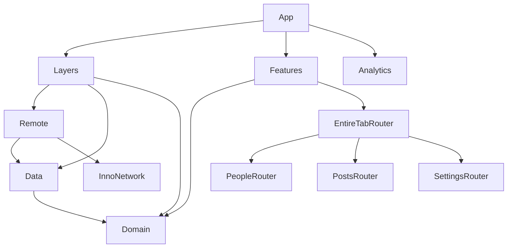

# InnoSample

[](https://github.com/InnoSquadCorp/InnoSample/actions/workflows/verify.yml)

[English](README.md) | [한국어](README.ko.md) | [Español](README.es.md) | [Deutsch](README.de.md) | [简体中文](README.zh-Hans.md) | [日本語](README.ja.md) | [Русский](README.ru.md)

这是一个模块化 SwiftUI 应用，也是新项目的起始骨架，集成了已发布的 **InnoDI、InnoFlow、InnoNetwork 和 InnoRouter** API。三个功能展示依赖组装、异步加载、类型化导航、跨功能意图以及原生 presentation 的生命周期。

本 README 说明仓库中的实际应用。[架构评审](Docs/ArchitectureReview.md)记录其他 API 的覆盖范围及验证边界。七种语言的 README 包含相同示例和命令；应用界面本地化是另一项工作。

<!-- section:requirements -->
## 环境要求与依赖

- 使用 **Xcode 27.1 / Swift 6.4** 的 macOS；项目语言设置为 Swift 6.3。
- [.mise.toml](.mise.toml)固定 **Tuist 4.202.5** 和 ripgrep 15.1.0。此 Tuist 版本保留 InnoNetwork 默认的 `Macros` package trait。
- 应用：**iOS/iPadOS 18+、macOS 15+**。随附的 watch companion：**watchOS 11+**。
- 共享模块 manifest 还声明 tvOS 18+ 和 visionOS 2+。完整应用 CI 验证 iOS、watch companion 和 macOS。

| 库 | 固定版本 | 职责 |
| --- | --- | --- |
| [InnoDI](https://github.com/InnoSquadCorp/InnoDI/tree/7.0.2) | 7.0.2 | 容器、生成 provider/override、依赖图验证 |
| [InnoFlow](https://github.com/InnoSquadCorp/InnoFlow/tree/6.0.2) | 6.0.2 | 状态、action、phase、异步 effect、类型化 output |
| [InnoNetwork](https://github.com/InnoSquadCorp/InnoNetwork/tree/6.1.1) | 6.1.1 | Endpoint 宏、transport、认证、重试、HTTP 缓存 |
| [InnoRouter](https://github.com/InnoSquadCorp/InnoRouter/tree/7.0.0) | 7.0.0 | Route、标签页、deep link、stack/split host、类型化 presentation 结果 |

[依赖 helper](Tuist/ProjectDescriptionHelpers/Dependency/TargetDependency+.swift)声明精确的远程发布版本，各项目列出所用 package。[Tuist/Package.swift](Tuist/Package.swift)刻意不设置全局 package 依赖或 linkage override。生成的项目、workspace 和 lockfile 不纳入 Git；`make verify-versions` 核对生成图中的 release revision 和 SwiftSyntax 604.0.0。

<!-- section:run -->
## 运行应用

先安装 mise 和选定的 Xcode，然后执行：

```bash
git clone https://github.com/InnoSquadCorp/InnoSample.git
cd InnoSample
mise install
make install-dependencies
make generate
make open
```

选择 **InnoSampleApp** scheme，以及 iOS Simulator 或 Mac。**InnoSampleWatchApp** 是随附的 watch target。示例 manifest 禁用了签名；部署到真实设备需要自行配置签名。

正常启动通过 Remote 使用 JSONPlaceholder。Debug 启动参数 `--uitesting` 用生成的 DI override 替换 repository，同时保留真实的 feature、reducer 和 router 组装。原生 UI 测试使用这个确定性 fixture 路径。

<!-- section:features -->
## 示例功能

| 功能 | 数据 | 交互 |
| --- | --- | --- |
| People | `/users` | 列表、详情、Overview sheet、打开负责人 Settings 详情的意图 |
| Posts | `/posts` | 列表、详情、Highlights sheet；窄屏 stack、宽屏双列 split |
| Settings | `/todos` | 列表、详情、仅已完成过滤器、Digest 结果、打开 People 详情的意图 |
| EntireTab | 共享子 coordinator | 生成标签页 ID 和 destination；协调 People ↔ Settings 和 deep link |

生成的 resolver 允许 `innosample` scheme 和 `host` host。可在已启动且安装应用的 simulator 上尝试：

```bash
xcrun simctl openurl booted 'innosample://host/people/1'
xcrun simctl openurl booted 'innosample://host/settings/1'
```

Watch companion 用原生列表/详情导航显示固定 People snapshot，并共享 Domain 模型。当前 watch 实现不包含同步和网络加载。

<!-- section:architecture -->
## 模块边界

每个模块都有独立的 `Project.swift`，由 [Workspace.swift](Workspace.swift)组装。箭头表示编译依赖。运行时 Layers 组装 Remote → Data → Domain，并向 Features 提供 `FeatureUseCaseContaining`。



| 边界 | 所有权与职责 |
| --- | --- |
| App | Root container、analytics adapter、Layers/Features 组装及生命周期 |
| Domain | Entity、repository protocol、基于共享 repository 的具体无状态 `callAsFunction()` use case |
| Data | Repository 实现、remote data-source 契约、DTO 映射、数据策略 |
| Remote | Endpoint、解码、transport 策略、Data remote 契约的实现 |
| Layers | 仅负责组装，提供 feature 用例而不暴露内部 container |
| Features | 通过 Domain use-case 输入组装子 Router target |
| Leaf Interface / Logic / UI / Router | 公开输入/输出 / 状态与 effect / 渲染与 callback / route 与 presentation |
| Leaf Testing / Tests | Fixture 与 helper / 可执行回归验证 |
| ThirdParties/Analytics | SDK wrapper 示例：interface framework、static 实现、测试 |
| Utils/SampleDesignSupport | 共享加载、错误、metric 等 UI 组件 |

Logic import Domain 和 InnoFlow，SwiftUI 与 InnoRouter 留在 UI/router 边界。UI 消费 interface/model 契约，不直接 import Domain、Data、Remote 或 InnoRouter。同级 feature 通过 EntireTab 交换类型化意图，不相互 import router。[LinkagePolicy](Docs/LinkagePolicy.md)说明 dynamic composition/interface framework 和 static 实现 target。

<!-- section:macros -->
## 宏集成

### InnoDI：构建与生命周期

完整的 [People container](Features/PeopleFeature/Router/Coordinator/PeopleFeatureContainer.swift) 通过生成的初始化和 shared provider 保持 coordinator：

<!-- source:Features/PeopleFeature/Router/Coordinator/PeopleFeatureContainer.swift -->
```swift
import InnoDI
import PeopleFeatureInterface

@DIContainerRole(role: ContainerRole.local, mainActor: true)
public struct PeopleFeatureContainer {
    @Input
    public var input: PeopleFeatureInput

    @Provide(.shared, PeopleFeatureCoordinator.self, with: [\Self.input])
    public var coordinator: PeopleFeatureCoordinator
}
```

[AppContainer](App/Sources/AppContainer.swift)使用 root 角色的 `@DIContainerRole`、按需 analytics provider，以及带 key-path binding 和 `featureRoot:` 的 `@SubContainer`。应用调用生成的 root-view helper。Container target 连接 `InnoDIDAGValidationPlugin`；测试覆盖生成的 override、prewarm、async provider 准备/重试/关闭、multibinding 和 `@GenerateMock`。应用直接消费 InnoDI，普通 feature-root helper 不需要 InnoDISwiftUI host。

### InnoFlow：状态与 effect

生产 reducer 使用 `@InnoFlow(phaseManaged: true, strictPhaseTotality: true)`、嵌套 State/Action/Output，以及使用生成 case path 的 phase map。[Settings reducer](Features/SettingsFeature/Logics/Reducer/SettingsFeatureReducer.swift)的这个片段将成功/失败映射回 action，并替换正在进行的加载：

<!-- source:Features/SettingsFeature/Logics/Reducer/SettingsFeatureReducer.swift -->
```swift
    private func loadTodos() -> ReducerEffect<Action, Output> {
        let loadTodos = dependencies.loadTodos

        return .perform(
            operation: { try await loadTodos() },
            success: Action.todosLoaded,
            failure: { error in
                .todosFailed((error as? LocalizedError)?.errorDescription ?? error.localizedDescription)
            }
        )
        .cancellable("settings-feature-load", cancelInFlight: true)
    }
```

Settings 用 `@BindableField` 实现已完成过滤器，用可写 observable model 连接 UI 的 `@Bindable` binding。Feature model 在 dispatch 时捕获有界类型化 output，通过 `for await` 消费并结束 capture。Logic 测试使用完整 TestStore assertion、ManualTestClock 和隐藏敏感信息的 instrumentation。

### InnoNetwork：endpoint 与策略

完整的 [People endpoint](Layers/Remote/Sources/User/Requests/FetchUsersRequest.swift) 把 method/path/认证与 protocol witness 的生成交给 `@APIDefinition`：

<!-- source:Layers/Remote/Sources/User/Requests/FetchUsersRequest.swift -->
```swift
import Data
import InnoNetwork

@APIDefinition(method: .get, path: "/users", auth: .anonymous)
struct FetchUsersRequest: RemoteRequest {
    typealias APIResponse = [UserRemoteModel]

    var featureName: String { "People" }
}
```

[RemoteClientFactory](Layers/Remote/Sources/Infrastructure/RemoteClientFactory.swift)将 bearer refresh/replay 限定在 `/todos`，使用有界指数重试、20 秒 timeout，并在 300 秒 cache-first 策略上启用 RFC 9111 cache。Persistent cache 上限为 25 MiB / 500 条。稳定 metadata 保持 GET cache 复用。Token rotation 是示例实现；JSONPlaceholder 没有真实认证服务。

### InnoRouter：生成契约

[SampleTab](Features/EntireTabFeature/Router/Tab/SampleTab+InnoRouterTab.swift)结合 `@Router` 与稳定的 `@TabItem(id:)` 声明，shell 在原生 TabView 中使用生成的 catalog。[SampleDeepLink](Features/EntireTabFeature/Router/DeepLink/SampleDeepLink.swift)使用 `@DeepLink` 和 origin allowlist。Leaf route enum 生成 destination 和 typed helper。

Router view 用 `@EnvironmentRouter` 发送命令，用 `@EnvironmentRouterState` 读取 presentation 状态。Digest 声明 `@PresentationResult(Bool.self)`：明确点击 Close 返回值并 acknowledge 一次；手势关闭、取消和拒绝是不同结果。测试还覆盖有界 Codable snapshot、draft、revision/event 和 RouterTestStore 完成。

<!-- section:navigation -->
## 导航所有权与自适应 Posts

共享 EntireTab coordinator 拥有生成的标签页选择状态。每个 leaf 拥有 stack/split host，所有子 coordinator 环境在标签页 destination 上方注入。这样可避免嵌套原生 navigation container 在返回标签页时重置子 path。

Posts 在共享 coordinator 中保留一个 configured RouterStore。标签页 viewport 观察宽度：**低于 800 pt** 时使用 RouterHost，否则使用含列表/详情列的 RouterSplitHost。`replaceHost` 在同一 store 中保留完整详情历史。Presentation 活跃时保留现有 host 和 dismissal handle，关闭后应用最后请求的 layout。测试覆盖双向切换、返回标签页、Highlights、Close 和 Back。

<!-- section:validation -->
## 验证

```bash
make verify-docs
make verify
make test-ui
make verify-ci
```

| 命令 | 范围 |
| --- | --- |
| `make verify-docs` | 七种语言的 section/代码/链接一致性、release 表、源代码片段、区分大小写的本地链接 |
| `make verify` | Install/generate、文档、resolved release、import 边界、exact-release DI DAG、11 个 macOS test suite、iOS + watch companion 和 macOS build |
| `make test-ui` | 专用 iPad mini simulator 上的六项原生 UI 回归测试 |
| `make verify-ci` | 完整 `make verify` 后执行 `make test-ui` |

单独 target：`make test-domain`、`make test-data`、`make test-remote`、`make test-leaf-features`、`make test-layers`、`make test-features`、`make test-analytics`、`make test-app`、`make build-app`、`make build-macos`。

UI 覆盖：People → Settings → People 和 Overview；Posts 选择/Highlights；标签页及 compact/split 切换后详情保持；两种宽度下 Highlights 与返回详情；Settings 过滤器和一次 Digest acknowledge；无 acknowledge 的手势关闭。

Selector 在已安装的兼容 iOS runtime 中优先选择 iPad mini (A17 Pro)，其次是 iPad mini (6th generation)。测试计时前完成启动，结束后关闭其管理的 simulator。也可指定现有设备或 xcresult 路径：

```bash
make test-ui SIMULATOR_ID=<simulator-udid>
UI_TEST_RUNTIME_VERSION=27.0 UI_TEST_RESULT_BUNDLE=/tmp/InnoSampleUI.xcresult make test-ui
```

[GitHub Actions](.github/workflows/verify.yml)在 main push 和 PR 上使用 Xcode 27.1 / iOS 27.0 执行相同流程并上传原生 UI 结果。CLI 的 trust-confirmation skip flag 不会跳过宏编译和 DAG 验证。Fixture 成功和未签名 build 不代表 live 服务器、实机部署或发布已验证。

<!-- section:maintenance -->
## 维护与更多文档

修改 API 或命令时同时更新七份 README，并运行 `make verify-docs`。检查会比较 section ID、代码块、链接目标、release pin 和源代码片段。译文与英文一同维护。

- [ArchitectureReview](Docs/ArchitectureReview.md)：API 覆盖、所有权决策、带日期的验证证据（韩语）。
- [LinkagePolicy](Docs/LinkagePolicy.md)：Package product 和 dynamic/static linkage（韩语）。
- [Tuist helpers](Tuist/ProjectDescriptionHelpers)：Target template、platform 设置、依赖、scheme。
- [Native UI tests](App/UITests/InnoSampleAppUITests.swift)：可执行的应用级流程。

可选 WebSocket/upload/download/OpenAPI/AWS/trust product、InnoStream、Protobuf 和 InnoBase 不在应用当前消费的功能范围内。Router snapshot 测试不代表应用级磁盘恢复；window/immersive driver 和 inspector 也不在当前应用中。
